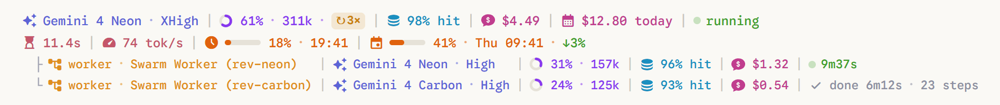
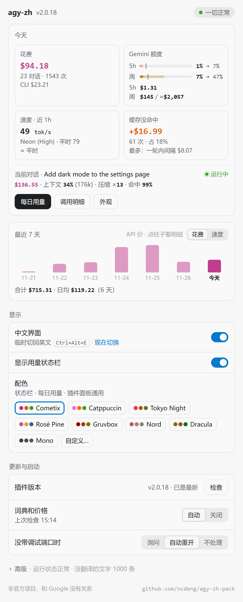
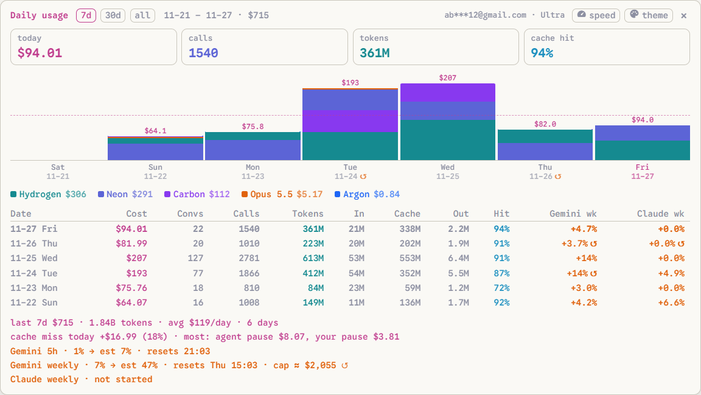

<div align="center">

# agy-zh

[简体中文](README.md) | [English](README.en.md)

A Chinese plugin for Antigravity Desktop: a full Simplified Chinese UI, plus a usage status bar above the input box. For Windows and macOS.

[](https://github.com/ncdeng/agy-zh-pack/releases/latest)
[](LICENSE)




</div>

> [!NOTE]
> This plugin is made for Chinese users. The status bar text is in English, but its tooltips, the plugin panel, the installer prompts and the file names in the download are in Chinese. If you only want the status bar, turn off "中文界面" (Chinese UI) in the plugin panel.

## Highlights

- **Full Chinese UI**: menus, settings, buttons, hints and the Swarm panel, with 3582 dictionary entries and 128 rules. Conversations, code and file names stay as they are. Press `Ctrl+Alt+E` (`Ctrl+Option+E` on macOS) to switch back to English at any time.
- **Usage at a glance**: two lines above the input box show the model (with the name the API actually returns), context, cache hits, conversation cost, today's cost, time to first token, output speed, and the 5h and weekly quotas. Each subagent gets its own line.
- **Will the quota last**: projects how much of each quota you will have used at reset, and when it runs out if it will. From your spending, it also estimates what the full 5h and weekly quotas are worth.
- **Daily usage panel**: cost for 7 days, 30 days or all history, tokens and quota per day, every call in detail, and output speed per model.
- **Cache misses**: finds large calls that missed the cache, and shows the extra cost and the cause (a pause, a compaction, a model switch).
- **Compaction viewer**: click `↻3×` after the context to see what the agent still has after an automatic compaction.
- **8 palettes, customizable**: Cometix, Catppuccin, Tokyo Night, Rosé Pine, Gruvbox, Nord, Dracula and Mono, each with light and dark versions that follow Antigravity. You can pick your own colors for cost, 5h quota, weekly quota and alerts.
- **agy CLI included**: CLI calls count toward cost, call details and quota estimates.
- **Signed updates**: click "更新" (Update) in the plugin panel; the plugin checks the author's signature and every file before it installs. The dictionary and prices update online every 6 hours.

## Install

**Windows**

1. Install Antigravity and sign in once.
2. Download `agy-zh-pack-v<version>.zip` from [Releases](https://github.com/ncdeng/agy-zh-pack/releases/latest) and extract it anywhere.
3. Double-click `一键安装.cmd`. If "Windows protected your PC" appears, click "More info", then "Run anyway".
4. From now on, open Antigravity from the Start menu, desktop or taskbar icon. The installer adds `--remote-debugging-port=0` to these shortcuts.

Antigravity can stay open during the install. If it was started without that flag, the installer asks you, and after you press Enter it reopens Antigravity.

**macOS**

1. Install Antigravity and sign in once.
2. Extract the download. Open Terminal, type `bash` and a space, drag `一键安装.command` into the window, and press Enter.
3. The installer asks whether to reopen Antigravity automatically when it starts without the debugging port. Press Enter for yes.

After the install, open **agy-zh** from the "Plugins" menu at the top right of Antigravity. To get a new version later, click "更新" (Update) in this panel. Keep the extracted folder: you need it to uninstall.

<details>
<summary>Upgrade from v1.x ("中文美化包")</summary>

Download the new package and run `一键安装` once. Your daily records and look settings move over automatically, and the old auto-start entries are removed.

</details>

## Translation

| Content | What happens |
|---|---|
| Menus, settings, buttons, hints, errors | Translated. Hover over an error to see the English original, for searching and bug reports |
| Swarm panel | UI text is translated; goals, tasks and messages written by agents stay as they are |
| Antigravity feature names | Artifact, Turbo, Coordinator and Swarm stay in English, as in the official docs; so do terms like MCP, URL and token |
| Names you or others chose | Conversation titles, project names, files and paths, branches and MCP server names are not translated |
| Single words with more than one meaning | For example Plan, Type and Space stay in English |

- Status bar only: turn off "中文界面" (Chinese UI) in the plugin panel. Translation only: turn off "显示用量状态栏" (show usage status bar).
- UI text with no translation is recorded in `i18n-missing.json` in the data folder, on your computer only. You can view and clear it under "高级" (Advanced) in the plugin panel. To help with the dictionary, paste entries from it into an issue.
- Some descriptions on the settings page come from the Antigravity backend. When the backend changes them, they show in English until the dictionary catches up.

## Status bar

| Line | Example | Meaning |
|---|---|---|
| First | `Gemini 4 Neon · XHigh` | Model: UI name and thinking level. When the model name the API returns does not match the UI name (usually a new model in a gray test), it follows in yellow, for example `· gemini-3.8-flash-n`. When they match, it is only in the hover text |
| | `61% · 311k · ↻3×` | Context: used share and tokens; the icon is a ring that fills up. `↻3×` means 3 automatic compactions; click it to open the compaction viewer |
| | `98% hit` | Cache hit rate of the last call |
| | `$4.49` | Total cost of this conversation, subagents included. A red badge appears when a single call costs $0.50 or more |
| | `$4.49 today` | Today's cost since midnight, all conversations and agy CLI. Click it to open the daily usage panel |
| | `running` | The model is generating |
| Second | `11.4s` | Time to first token |
| | `74 tok/s` | Output speed |
| | `1% · 19:41` | 5h quota: used share and reset time |
| | `1% · 11-29 09:41 · ↓3%` | Weekly quota: used share, reset time, and how far ahead (↑) or behind (↓) an even pace |
| Subagent | `├ research · Paper Reviewer … ● 1m05s` | One line per subagent: type and task, model, context, hit rate, cost, and state (run time, `waiting` or `✓ done`) |

You can turn off each item under "显示 → 状态栏显示哪些项" (Display → Status bar items) in the plugin panel. All items are shown by default. An item that is turned off is also hidden in the subagent rows.

## Plugin panel



| Section | Content |
|---|---|
| Top | Version and a status dot. A banner with a "restart with flag" or "update" button appears when the debugging port is missing or a new version is out |
| Today | Four tiles: cost; 5h and weekly quota for the current model group (solid = used, light = projected use at reset, with spent money and the estimated full quota below); output speed in the last hour against usual; extra cost from cache misses. A tile turns yellow when something is off |
| Current conversation | Total cost, context, compactions, cache hit rate |
| Last 7 days | Switch between cost per day (click a bar for that day's calls) and output speed per hour |
| Display | Chinese UI and status bar switches; status bar items; palette |
| Updates and startup | Plugin version and "检查" (Check); online dictionary and prices; what to do without the debugging port |
| Advanced | Running state, file and signature check, memory, untranslated UI text |

## Daily usage panel

Click `$x today` in the status bar to open it. Click again or press `Esc` to close it.



| Part | Content |
|---|---|
| Top | Today's cost, calls, tokens and cache hit rate; at the right, the account (masked email), `speed` and `theme` |
| Chart | Cost per day for `7d`, `30d` or `all`, colored by model. `↺` marks a day when a quota was reset early |
| Table | Cost, conversations, calls, tokens, hit rate and weekly quota used, per day. Click a row to open that day's calls |
| Call details | Time, conversation, model, cost, tokens, hit rate, speed and time to first token for each call. Group by conversation or by model; show only cache misses or only agy CLI. Calls of $0.50 or more are red |
| speed | Median output speed per hour and per day; marks a model that is 40% or more slower than usual |
| Bottom | Total and daily average for the range; extra cost from cache misses today; one line per 5h and weekly quota: used → estimate, reset time, `cap ≈` |

After the install, the plugin backfills earlier days from the local conversation databases (backfilled days have no quota records). History is kept for 400 days.

## Look

Click `theme` at the top right of the daily usage panel. Changes apply at once, in all windows.

| Option | Values | Default |
|---|---|---|
| Palette | Cometix, Catppuccin, Tokyo Night, Rosé Pine, Gruvbox, Nord, Dracula, Mono | Cometix |
| Style | `plain` with dividers; `pill` rounded blocks; `powerline` arrow blocks | `plain` |
| Quota bars | `thin`, `cells` (10 cells), `ring`, `none` | `thin` |
| Detail | `compact`, `full` (context with its limit, cache with token count) | `compact` |
| Icons | `material`, `outline`, `unicode` (no icon font), `off` | `material` |
| Per-item icon | Each item has one alternative icon, for example a three-step gauge for output speed | Default icons |

- You can also change the palette under "显示 → 配色" (Display → Palette) in the plugin panel. The status bar, the daily usage panel and the plugin panel share one palette.
- "自定义…" (Custom) lets you change 4 main colors: cost, 5h quota, weekly quota, and alert / over quota. Light and dark themes are stored separately. Click "还原成 <palette>" (Restore) or any palette to go back to its colors.
- Cometix is the default palette of this project. Its name and look come from the cometix preset of ccline; its colors are based on Catppuccin.

## Quota estimates

At the bottom of the daily usage panel, one line per quota, for example:

```
Gemini 5h · 1% → est 7% · resets 21:03 · cap ≈ $170
Gemini weekly · 7% → est 47% · resets Thu 15:03 · cap ≈ $2,055 ↺
```

| Text | Meaning |
|---|---|
| `7% → est 47%` | 7% used; at the current pace, 47% at reset |
| `full 12-1 20:00` | At the current pace, the quota runs out at this time |
| `cap ≈ $2,055` | What the full quota is worth = cost in this cycle ÷ used share |
| `(rough)` | Less than 5% used, or less than 1 day into the week: the number is rough |
| `↺` | This cycle started after an early reset |
| `not started` | This group has not been used in this cycle |

- For the weekly quota, the pace is the last 24 hours (at least 6 hours of readings), or the week's average if there is no such data. For the 5h quota, the pace is the average over this 5-hour window, starting 30 minutes in.
- Cost uses standard API prices; tokens are projected in the same ratio. The tooltip shows money and tokens, and the cap of each of the last 4 weekly cycles. A smaller cap can mean that the quota got tighter.
- Quotas belong to the account. With family sharing, or when other computers use the same account, `cap` is too low and `est` is too high.

## Cost

Cost = tokens × the public standard API prices of Google / Anthropic, in US dollars. Subscriptions are charged against quotas; these amounts are estimates for comparison.

<details>
<summary>Price table (USD per million tokens)</summary>

| Model | Input | Cache read | Output (incl. thinking) |
|---|---|---|---|
| Gemini 4 Neon (incl. Orchestrator (Neon) planning) | $3 | $0.15 | $15 |
| Gemini 4 Carbon / Argon (incl. Orchestrator planning) | $2 ($4 from 12-01) | $0.10 ($0.20 from 12-01) | $10 ($20 from 12-01) |
| Gemini 4 Hydrogen (incl. Orchestrator executor) | $1.50 | $0.075 | $7.50 |
| Gemini 3.8 Flash | $0.75 ($1.50 from 2027-01-01) | $0.075 ($0.15 from the same day) | $3.75 ($7.50 from the same day) |
| Claude Opus 5.5 | $4 | $0.20 | $20 |
| Claude Sonnet 5.5 | $2 | $0.10 | $10 |

- Claude cache writes use the 5-minute cache price: Opus 5.5 $5, Sonnet 5.5 $2.50.
- `gemini-4-hydrogen-tiered-high` (used by the browser subagent) uses the Gemini 4 Hydrogen price. GPT-OSS 120B has no price and is not counted.
- Sources: Google AI Studio pricing page (2026-11-16; Neon 2026-11-19), Anthropic official prices (2026-11-03). Claude runs through Google Vertex in Antigravity.
- Prices come from the online table `data/prices.json`, which GitHub Actions checks against the official pricing pages every day. If it cannot be downloaded, the built-in `PRICES` in `statusbar.js` are used.
- Each call counts on the day it started, at that day's price. `/btw` and forked conversations count only their own calls, not the copied ones.

</details>

## Cache misses

In each conversation, every call is compared with the last call of the same model that had 20k or more input tokens. If the earlier context should have come from the cache but was charged at full price, the call is a miss. Extra cost = missed tokens × (input price − cache read price).

| Cause | Shown as | Rule |
|---|---|---|
| Model switch | `model switch` | The model appears in the conversation for the first time |
| Compaction | `compaction` | A compaction happened in between, or the input is 40% or more smaller |
| Your pause | `your pause` | 1 minute or more passed, with a message from you in between |
| Agent pause | `agent pause` | 1 minute or more passed, with no message from you (long command, approval, subagent) |
| Pause (agy CLI) | `pause` | CLI calls cannot tell whether you sent a message in between |
| Other | `other` | A miss within 1 minute |

On the author's computer, 4143 calls from 11-17 to 11-24: with less than 30 seconds between calls, Gemini hit the cache 90%–95% of the time; after 2–5 minutes, 59% of Hydrogen calls and 41% of Carbon calls missed completely. In those 7 days, misses cost about $161 extra, 39% of the total.

## Updates

**Dictionary and prices** download from this repository every 6 hours. The plugin asks `api.github.com` for the latest commit on main, then downloads `i18n/zh-CN.json`, `i18n/zh-CN.rules.json`, `data/prices.json` and `data/meta.json` at that commit from jsDelivr (fallback: `raw.githubusercontent.com`).

- Downloads use Antigravity's own network and proxy settings, without cookies.
- Dictionary entries are inserted as text only; prices are used as numbers only. Files with a bad format, 20% fewer entries, or out-of-range prices are not used.
- Online entries override bundled entries with the same key.
- Set "词典和价格" (Dictionary and prices) to "关闭" (Off) in the plugin panel to stop all of this, including the new-version check.

**New versions** install only when you click "更新" (Update):

1. Download that version's signed manifest `plugin-manifest.json` and check its Ed25519 signature with the public key in the plugin.
2. Download each file and check its sha256 and size.
3. When everything matches, back up the current files to `backup/v<version>/` in the data folder, then replace them. On an error, restore from the backup.
4. The plugin restarts by itself (about 2 seconds). Antigravity stays open.

The signing key exists only on the author's computer. The public key fingerprint is `246b2f1a387df2c5`. Changed code on GitHub cannot be installed without the signature.

## Debugging port

The plugin changes the UI through the Chromium remote debugging port of Antigravity. From Antigravity 2.33.0, this port exists only when Antigravity starts with `--remote-debugging-port`.

- **Windows**: the installer adds `--remote-debugging-port=0` (random port) to shortcuts whose target is `%LOCALAPPDATA%\Programs\antigravity\Antigravity.exe`. When an Antigravity update rewrites the shortcuts, the plugin adds the flag back.
- **macOS**: Antigravity opened from the Dock or Launchpad never has the flag.

When Antigravity started without the flag, the plugin acts after about 20 seconds, as set in the panel:

| Setting | What it does |
|---|---|
| Ask (Windows default) | Asks whether to reopen Antigravity now |
| Reopen automatically (recommended on macOS) | Closes Antigravity normally and opens it with the flag, in about 6 seconds. Conversations are kept; running tasks stop |
| Do nothing | Nothing; the UI stays in English |

To check the Windows shortcuts:

```powershell
powershell -ExecutionPolicy Bypass -File "$env:USERPROFILE\.gemini\config\plugins\agy-zh-pack\debug-port.ps1" -Mode check
```

## Data

| Location | Path |
|---|---|
| Plugin folder | `~/.gemini/config/plugins/agy-zh-pack` (Windows: `%USERPROFILE%\.gemini\config\plugins\agy-zh-pack`) |
| Data folder | `~/.gemini/antigravity/plugin_data/agy-zh-pack` (Windows: `%USERPROFILE%\.gemini\antigravity\plugin_data\agy-zh-pack`) |

Files in the data folder:

| File | Content |
|---|---|
| `usage-history.json` | Cost, calls, tokens, quota share and speed summary per day |
| `cost-day.json` | Today's cost per conversation |
| `quota-samples.json` | Quota readings (8 days) |
| `cli-index.json` | Days with calls for each agy CLI conversation database |
| `look.json` | Look settings and the online update switch |
| `settings.json` | What to do without the debugging port |
| `i18n-missing.json` | Untranslated UI text |
| `remote/` | Downloaded dictionary and prices |
| `inject.log`, `relaunch.log` | Logs |

- No conversation content is stored. For the account, only the masked email and an ID (a hash of the email) are stored.
- Updates replace the plugin folder; the data folder stays.
- Conversation databases, quotas and the account are read only. Nothing sent to Google is changed.
- Network access has three uses only: the icon font from Google Fonts; online dictionary and prices; downloading a new version when you click "更新".
- The plugin panel API listens only on `127.0.0.1` and needs the token that Antigravity gives it.

## Risks

- Section 6 of the Antigravity additional terms of service does not allow "using the Service in connection with products not provided by us". With a third-party plugin, your account can be suspended.
- The debugging port is open on `127.0.0.1`. Other programs on your computer can control Antigravity windows through it.
- "Reopen automatically" closes Antigravity, and running tasks stop. Choose "Ask" or "Do nothing" to avoid this.
- The plugin depends on internal page structure and interfaces of Antigravity. After an Antigravity update, some features can stop working, and new UI text shows in English first.

## Uninstall

Run `一键卸载` (on Windows, double-click `一键卸载.cmd`; on macOS, run `一键卸载.command` with `bash` in Terminal):

- Removes the flag from the shortcuts and deletes the plugin folder. Reload the Antigravity window to get English back.
- Asks whether to delete the data folder too. Keep it to continue your records after a reinstall.
- If you used the "author's theme" (v2.0.16 and earlier), asks whether to restore your original colors.

## Requirements

- From Antigravity 2.35, use v2.0.12 or later. Tested with Antigravity 2.35.2 on real Windows 11 and macOS machines; see [docs/testing.en.md](docs/testing.en.md) for what each version was tested on.
- The plugin runs on the Node bundled with Antigravity. No separate Node.js is needed.
- The icon font loads from Google Fonts. If it cannot load, choose `unicode` icons in the look settings.

## Development

```bash
node --test "tests/*.test.mjs"      # unit tests (Node.js 22.13+)
node tools/dev/probe.mjs all        # with Antigravity open, check the plugin in the real UI
```

How the plugin starts, injects and reopens Antigravity, how to run from source, package and release, and what each file does: see [docs/development.en.md](docs/development.en.md).

## Credits

- The status bar look and its English wording follow the cometix preset of [CCometixLine](https://github.com/Haleclipse/CCometixLine) (ccline) by Haleclipse; the look layers (palette, style, bars, detail) and the context ring follow ccline v2. No ccline code is used. Thanks to Haleclipse for such a good-looking status bar.
- The 5h and weekly quota display follows agyline.
- Palette colors come from the public definitions of [Catppuccin](https://catppuccin.com), [Tokyo Night](https://github.com/folke/tokyonight.nvim), [Rosé Pine](https://rosepinetheme.com), [Gruvbox](https://github.com/morhetz/gruvbox), [Nord](https://www.nordtheme.com) and [Dracula](https://draculatheme.com) (light is the official Alucard). Nord has only a dark version; its light version darkens the pale colors.
- Icons: the status bar uses Material Symbols (Apache License 2.0); the plugin icon (a four-point star with an orbit) is drawn by this project; the alternative model icon is meteor from [Font Awesome Free](https://fontawesome.com) 6.7.2 ([CC BY 4.0](https://fontawesome.com/license/free), Fonticons, Inc.).

## License

[MIT](LICENSE)

This is an unofficial project with no connection to Google. Antigravity is a product of Google. The keys in the dictionary `zh-CN.json` are the original English UI text of Antigravity, used to find the text to translate.
