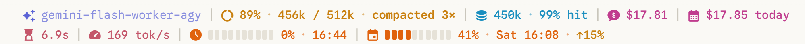

<div align="center">

# agy-zh

[简体中文](README.md) | [English](README.en.md)

**An unofficial Simplified Chinese plugin for Antigravity Desktop (Windows / macOS)**

Chinese UI translation · usage status bar above the input box · optional color theme · signed one-click updates

[](https://github.com/ncdeng/agy-zh-pack/releases/latest)
[](LICENSE)




<sub>Real screenshot: a long conversation</sub>

</div>

> [!WARNING]
> This is a third-party project. It has no connection with Google. By default it only changes what you see on your own computer and only reads local data. Read [Risks](#risks) before you install.

> [!IMPORTANT]
> **From v2.0, agy-zh is an Antigravity plugin (v1.x was called "中文美化包").** If you installed v1.x, download the v2.0 package and run `一键安装` (install) once. Your daily records and look settings from the old version are moved over, and the old autostart is removed. After that, when a new version is out, click "更新" (update) in the plugin panel; you do not need to download the package again. Tested with Antigravity 2.35.1. From Antigravity 2.35, the status bar and the call details of v2.0.11 and earlier get no data; update to v2.0.12.

> [!NOTE]
> This pack is made for Chinese users. It translates the Antigravity UI into Simplified Chinese. The status bar text is in English, but its hover tooltips, the plugin panel, the installer prompts and the file names in the download are in Chinese. If you only want the status bar, see [Status bar only](#status-bar-only-no-translation).

## Quick start

**Windows**

1. Install Antigravity and sign in once.
2. Download the latest `agy-zh-pack-v<version>.zip` from [Releases](https://github.com/ncdeng/agy-zh-pack/releases/latest). Extract it to any folder. Do not run it from inside the zip.
3. Double-click `一键安装.cmd` (install). If Windows shows "Windows protected your PC", click "More info", then click "Run anyway".
4. The installer asks one optional question: use the author's color theme. If you are not sure, press Enter (the answer is "no").
5. You do not need to close Antigravity. If Antigravity was started without the debugging port flag this time, the installer asks you; after Enter it closes Antigravity and opens it again with the flag when the install is done.
6. From now on, open Antigravity from the Start menu, desktop or taskbar icon. The installer added a start flag to these shortcuts.

**macOS**

1. Install Antigravity and sign in once.
2. Download and extract the package. Open Terminal, type `bash` and a space, drag `一键安装.command` (install) into the Terminal window, and press Enter.
3. The installer asks two questions: whether to reopen Antigravity automatically when it starts without the debugging port flag (recommended: press Enter for "auto"), and whether to use the author's color theme.

After the install, the plugin panel is in the "Plugins" menu at the top right of Antigravity, under the name "agy-zh". To change the color theme, run `配色开关` (color toggle). To uninstall, run `一键卸载` (uninstall). Keep the extracted folder.

## Defaults

| Feature | Default | Changes what is sent to Google? |
|---|---|---|
| Chinese UI translation | On | No. It only changes the local display |
| Usage status bar | On | No. It only reads local data |
| Author's color theme | Off | No. It only changes the theme colors of your local Antigravity |
| Online updates of the dictionary and prices | On | No. Every 6 hours it asks GitHub for the latest commit of this project, then downloads the dictionary and price table from this project's GitHub repository (through jsDelivr). These are plain download requests; no data is uploaded. You can turn it off; see [Online updates](#online-updates) |
| Version updates (code) | Only when you click "更新" (update) | No. Before it installs, it checks the signature with the author's public key; see [Version updates](#version-updates) |
| Start without the debugging port | Windows: ask you; macOS: as chosen at install | No. It only closes Antigravity and opens it again with the flag; see [Without the debugging port flag](#without-the-debugging-port-flag) |

Zoom, font and contrast are never changed.

## Features

### Chinese UI translation

Menus, settings, buttons and hints are shown in Chinese (a dictionary of 3469 entries and 111 regex rules). Conversation content, code and file names are not translated. From v2.0.7, when a text made of several sentences (for example a description and a retirement date in the model menu) is not in the dictionary, it is split at the periods and translated sentence by sentence. It is shown in Chinese only if each sentence has a translation. From v2.0.8, the Swarm panel of Antigravity (a separate plugin frame) is also translated: tabs, states, counts and filters are shown in Chinese, and the goal, task titles and messages written by the agents stay as written.

Some things are not translated on purpose:

- **Names of Antigravity features**: Artifact, Turbo, Coordinator and Swarm stay in English (for example "Turbo 模式", "Artifact 评论"), so that they match the official docs and the community and are easy to search. Terms such as MCP, URL, SSH and token also stay in English.
- **Names that you or third parties give**: conversation titles, project names, files and paths, automation names, Coordinator names, branch / repository / worktree names, SSH hosts, plugin titles and MCP server names are not translated, even when they are the same as a dictionary word.
- **Single words that change meaning without context**: for example Plan (it can mean a subscription plan or a work plan), Type and Space stay in English when they stand alone.
- **Error messages** are translated, and the original English text shows when you hold the mouse over them, so you can search for it or report it.

#### Switch back to English

From v2.0.8, press `Ctrl+Alt+E` (`Ctrl+Option+E` on macOS) to show the whole page in English, for example to compare with the official documentation. Press it again to switch back to Chinese. All windows and the Swarm panel switch together. A reload switches back to Chinese, and no setting is changed. The "运行状态" (status) section of the plugin panel also has a "现在切换" (switch now) button. AltGr+E (used for € on some European keyboards) does not switch.

#### Untranslated UI text

From v2.0.7, UI text that has no translation is recorded in `i18n-missing.json` in the data folder. The "没翻译的界面文字" (untranslated UI text) section of the plugin panel shows the count. You can expand it to see the latest 30 items, or clear the list.

- The file stays on your computer. It is not uploaded.
- The plugin does not record paths, URLs, email addresses, file names, model names and single code-like words. Texts that are different only in their numbers are recorded as one item (for example "Retry in 5 seconds" and "Retry in 12 seconds"). But names shown in the UI, such as project names and conversation titles, can be recorded.
- To help with the dictionary, you can paste the UI text from the file into a GitHub issue of this project (remove names that you do not want to make public first).
- A name that must stay in English is written in the dictionary with the same text as the translation (for example `"Swarm": "Swarm"`). Then it is not recorded again.

#### Status bar only (no translation)

Delete `i18n/zh-CN.json` in the plugin folder (see [What the installer does](#what-the-installer-does)), then press `Ctrl+R` (`Cmd+R` on macOS) once in Antigravity. The UI goes back to English and the status bar stays. The "文件" (files) line in the plugin panel then shows that 1 file does not match the signed manifest; this is expected. A reinstall or a version update puts the file back.

### Usage status bar

Two fixed lines above the input box. Each item is a colored icon with text in the same color. Like ccline, the status bar text is in English. Hover over any item to see a detailed tooltip (in Chinese). You can change the colors and the style; see [Look](#look).

| Line | Example | Meaning |
|---|---|---|
| Line 1 | `gemini-flash-worker-agy` | Model: the name in the UI, plus the model name that the API actually returns. For Gemini models, it turns yellow when the two do not match |
| | `89% · 456k · ↻3×` | Context: the icon is a ring that fills as the context fills, then percent used and tokens used. If the conversation was auto-compacted, a small pale-yellow badge follows; the number is how many times. The tooltip shows the limit, a bar, the tokens and percent of each part that Antigravity reports, the free space, and at which steps it was compacted. From v2.0.8, click the badge to open the compaction viewer (see "Compaction viewer" below) |
| | `99% hit` | Cache: the cache hit ratio of the last call; the tooltip shows how many tokens were read from cache |
| | `$17.81` | Total cost of this conversation (subagents included). Hover to see the input, cache and output tokens of the last call and the cost of each. From v2.0.8, when the last call cost $0.50 or more, a small red badge follows (for example `!$1.82`; it flashes when it first shows). Its hover text gives the cache hit ratio of that call, how much the cache would have saved, and the usual causes |
| | `$17.85 today` | Total cost today (from local midnight, all conversations). Click it to open the [daily usage panel](#daily-usage-panel) |
| | `running` | The model is generating. When it is not generating, this item keeps an empty space, so the bar does not wrap and jump when generation starts or stops. In a narrow window this item gets smaller first, so it does not move to the next line |
| Line 2 | `6.9s` | Time to first token |
| | `169 tok/s` | Output speed |
| | `0% · 16:44` | 5-hour limit: percent used (with a bar) and reset time |
| | `41% · Sat 16:08 · ↑15%` | Weekly limit: percent used, reset time, and how far ahead (↑) or behind (↓) an even pace you are |
| Subagents | `├ research · Paper Reviewer … ● 1m05s` | Each subagent gets its own line, joined in a tree with `├` and `└`; the columns of these lines are aligned. The items are: subagent type and task, model, context, cache hit, the cost of this subagent only, and status. The status is `● time running`, `● waiting` (it waits for your approval) or `✓ done time · N steps`; hover to see its current step and its last steps. The line closes about 10 seconds after the subagent ends. In a subagent window, the bar shows that subagent's own data |

The look follows the cometix theme of [CCometixLine](https://github.com/Haleclipse/CCometixLine) (ccline, a status line for Claude Code) by Haleclipse: two lines, colored icons with text in the same color, `|` between items, `·` between numbers in one item, and bars for the limits. This project does not use ccline code. The status bar was written again for Antigravity.

#### Look

Click `$x today` to open the [daily usage panel](#daily-usage-panel), then click `theme` at the top right. At the top is a gallery of color palettes. Each card is a live copy of your status bar; click a card to use that palette. The other options are below it. A change applies at once.

| Option | Values | Default |
|---|---|---|
| Palette | Cometix, Catppuccin, Tokyo Night, Rosé Pine, Gruvbox, Nord, Dracula, Mono | Cometix (this project's own palette) |
| Style | `plain`: text with vertical-line separators; `pill`: a rounded background for each item; `powerline`: arrow-shaped color blocks | `plain` |
| Bars (limits) | `thin`: a thin bar; `cells`: 10 cells; `ring`: a small ring; `none`: no bar | `thin` |
| Detail | `compact`: no context limit, cache shows only the hit ratio; `full`: context with limit, cache with tokens read | `compact` |
| Icons | `material`: filled icons; `outline`: line icons; `unicode`: plain characters (no online icon font); `off`: no icons | `material` |
| Swap (per item) | Each item has one alternative icon. Click to switch between the default and the alternative. For example, the model can use a comet, and the output speed can use a 3-step gauge (the needle points to slow / medium / fast: below 30, 30 to 60, above 60 tok/s) | All default icons |

- Each palette has a light and a dark version. The version follows the light or dark theme of Antigravity. The colors come from the published definitions of each palette (see [Credits](#credits)). Nord has only an official dark version, so its light version uses darker forms of the pale colors.
- Your choice is kept in `look.json` in the data folder. The plugin saves it within 30 seconds and sends it to the other windows. To go back to the defaults, click `reset` at the top right of the Theme page, or close Antigravity and then delete the file.
- The layers (palette, style, bar glyphs, detail) and the "gauge instead of icon" idea (the context icon is a ring that fills) follow ccline v2. This project does not use ccline code.

#### Daily usage panel

Click `$x today` in the status bar. A panel opens above the status bar. It is as wide as the input box and uses all the height above the status bar. Click it again, click outside the panel, or press `Esc` to close it. At the top right are the signed-in account (the email is masked, for example `ab***12@gmail.com · Ultra`) and the `theme` button, which opens the [Look](#look) settings.

- **Top cards**: today's cost, calls, total tokens and cache hit ratio.
- **Bar chart**: the estimated cost of each day in the last 7 days, the last 30 days, or all days (`all`, from v2.0.5: from the first day with records to today, up to 400 days; with more than 62 days, each bar is one week), with one color for each model. Hover over a bar to see that day's details.
- **Table**: one row for each day, with cost, conversations, calls, total tokens, input / cache / output tokens, cache hit ratio, and how many percentage points of the weekly limit were used that day (Gemini group and Claude group separately).
- **Call details** (from v2.0.8, the cost cell of a call of $0.50 or more is red with "!"; hover to see the cache hit ratio and likely causes, and the total next to the title gives how many such calls there are; on the author's computer, 93% of these calls had a cache miss; from v2.0.9, the hit cell of a call with a cache miss is yellow, its hover text gives the missed tokens, the extra cost and the cause, the total next to the title shows `miss +$X`, `all calls | cache misses` shows only these calls, and the per-conversation view has a `Miss` column; see "Cache misses" below): click a day in the table to see each model call of that day (today or an earlier day): time, conversation, model, cost, input, output, cache read, cache write, hit ratio, output speed, time to first token and total time. The newest call is at the top. The first 600 rows are listed, and `show 600 more` / `show all` below the table shows more; the totals include all calls. The row below the title (from v2.0.6): `calls | by conversation` switches between one row per call and one row per conversation (sorted by cost; click a row to go back to the calls and see only that conversation, and click `×` to clear it); `all | desktop | CLI` appears when the day has agy CLI calls; a model filter appears when the day used two or more models (grouped by price name, such as Carbon or Neon). Days older than 32 days also have call details (from v2.0.6; CLI databases are read when needed, so the first open can take a few seconds). While it is open, it refreshes in the background every 30 seconds and changes the table only when the data changed, so it does not flicker or jump back to the top. Click `← usage` to go back.
- **Bottom lines**: the total (cost and tokens) and daily average for the period; from v2.0.9, one line for the extra cost of today's cache misses, for example `cache miss today +$60.67 (34%) · your pause $27.90 · other $24.61` (hover to see the number of calls and the cost for each cause; click to open today's call details with only the missed calls); and one line for each weekly limit group (see "Weekly limit estimate" below).
- **`↺` early reset** (from v2.0.4): if a weekly limit is reset before its planned reset time (for example, on 2026-11-24 Google reset the Gemini weekly limit early), the date under that day's bar and the limit cell in the table get a `↺`. Hover to see when the reset happened, how much was used before it, and the planned reset time. If the current period started after an early reset, the bottom line ends with `↺ early reset 11-24`.

The data is kept in `usage-history.json` in the data folder for 400 days (from v2.0.5; before, 90 days). It holds only amounts, call counts, token counts and limit ratios, not conversation content. Limit records are kept for each account separately, so they do not mix after you change accounts. The file keeps only the masked email and an account ID (a hash of the email), not the full email.

**Compaction viewer** (from v2.0.8): click the compaction badge `↻N×` after the context to see what the agent still has after the last compaction. When the backend compacts the context, Antigravity replaces the old steps with one resume message: all your requests from the removed part (as written), a checkpoint summary (task overview, progress, key findings, errors and fixes, active context, next steps, commitments and constraints), the list of artifacts, and the location of the conversation log. File contents that were read, command output and reasoning are gone. The viewer shows the number of requests and artifacts and the summary. It reads them from the local conversation log (`~/.gemini/antigravity/brain/<conversation>/.system_generated/logs/transcript_full.jsonl`), read-only. If the agent "forgets" something after a compaction, first check if the summary has it, then remind the agent of the missing part.

**Cache misses** (from v2.0.9): in each conversation, each call is compared with the last large call (input of 20k tokens or more) of the same model. If the earlier context could have come from the cache but this call paid the full price for it, the call is a cache miss. Missed tokens = the smaller input of the two calls − the cache read of this call; less than 20k missed tokens is not counted. Extra cost = missed tokens × (full input price − cache read price); for Claude, a miss writes the content to the cache, so the cache write price is used. The cause is found in the order of the table:

| Cause | Shown as | Rule |
| --- | --- | --- |
| Model change | `model switch` | The first call of this model in the conversation, and the last large call used another model (the cache of the new model is empty) |
| Compaction | `compaction` | A compaction step is between the two calls, or the input is more than 40% smaller than before |
| You waited | `your pause` | 1 minute or more after the end of the last call, and you sent a message between them |
| Pause in a turn | `agent pause` | 1 minute or more, and no message from you between them (a long command, waiting for your approval, waiting for a subagent) |
| Pause (agy CLI) | `pause` | agy CLI calls have no step data, so it is not known whether you sent a message between them |
| Other | `other` | Less than 1 minute after the end of the last call (the server did not use its cache, or the earlier content changed) |

The limits come from 4143 calls on the author's computer from 11-17 to 11-24: when two calls in a conversation are less than 30 seconds apart, the Gemini cache hit ratio is 90% to 95%; at 2 to 5 minutes, 59% of the Hydrogen calls and 41% of the Carbon calls had no cache hit at all; the Claude cache stops after about 5 minutes (few samples). In these 7 days, misses cost about $161 more, 39% of the cost: about $91 after pauses of 1 minute or more, about $61 after less than 1 minute, and less than $9 for compaction and model changes together. The data is the same as in the call details (read from the local backend, read-only, not sent to Google). It is an estimate: the missed tokens assume that the earlier context should have come from the cache, but the server decides what it actually reuses.

**agy CLI usage** (from v2.0.4): when other tools call the agy CLI directly, they use the same account, so the limit percentages already include the CLI usage. The plugin also opens the CLI conversation databases read-only (`~/.gemini/antigravity-cli/conversations/*.db`, under `%USERPROFILE%` on Windows), groups the time, model and token counts of each call by day, and adds them to today's cost in the status bar, the cost / calls / tokens in the panel, `cap ≈`, and the call details (the conversation column shows `CLI · title`). The hover text shows the desktop part and the CLI part separately. The first time, it reads all CLI databases (167 databases, 1.7 GB, about 7 seconds on the author's computer); after that, it reads again only the changed ones, every 30 seconds. When today's usage changes, the status bar is updated at once, so while the CLI is running it is at most about 30 seconds late. In the call details, the CLI conversation names come from the CLI's own conversation summaries; conversations started by other tools usually have no title, so the start of the first message is shown.

**Weekly limit estimate** (one line for each group, for example `Gemini weekly · 3% used · cap ≈ $952 / 2.15B tok (rough) · resets 11-29 09:41 · est 45% at reset (rough)`):

- `cap ≈`: this computer's estimated cost and tokens in this limit period (from 7 days before the reset time to the reset time), divided by the percent used in the period. It estimates how much cost and how many tokens the full weekly limit is worth. From v2.0.5, on the day the period starts, only the calls after the start time are counted (by the time of each call; until that is calculated, the whole day is used).
- `est … at reset`: at the recent usage rate, about how much will be used at the reset time. If the limit will run out before that, it shows `full` and the expected time. The rate comes from the average of this period and from the last 24 hours (with at least 6 hours of readings). The readings are kept in `quota-samples.json` for 8 days.
- Both numbers have `(rough)`: the used ratio goes up and down, and early in a period, with little use, the error is large. Hover to see the method and the remaining limit.
- Earlier periods (from v2.0.6): at each period change (a normal reset or an early reset), the plugin records the start and end time and how much was used before the end. The hover text lists the cost and `cap` of the last 4 periods (the cost uses the time of each call). After a few periods, a clearly smaller `cap` can mean that the limit was made smaller. Before v2.0.6, only early resets were recorded.

The weekly limit used in a day is the net change in each limit period: the last used ratio seen that day minus the used ratio at the start of the day. If a new period starts during the day, the parts are added. The reason: in one period the used ratio goes up and down (in one test, it went from 1.699% to 1.594% in 6 minutes while the model was generating). v1.4.x added only the increases, so an increase after a drop was counted again and the daily number was too high. After you upgrade to v1.5.0, earlier weekly records are calculated again with the new method. From v2.0.4, each period is recorded as a separate part. When a limit is reset, the readings sometimes go back to the old period once (seen on 2026-11-24); the plugin then continues that old part and does not count the old period's usage again as new usage (that day was recorded as 14.84%; the correct number was 7.06%). After the upgrade, days that the readings in `quota-samples.json` cover completely are calculated again once.

- Limit used while Antigravity is closed (for example with the agy CLI) is counted on the next day that the plugin sees it.
- The limit belongs to the account. If the account uses Google family sharing, or is also used on another computer, the limit includes other people's usage. Then `cap ≈` is too low (their usage raises the limit, but their cost is not in this computer's cost), and `est` is too high.

After the install, the plugin fills in earlier days once: it opens Antigravity's own conversation databases read-only (`%USERPROFILE%\.gemini\antigravity\conversations\*.db` on Windows, `~/.gemini/antigravity/conversations/*.db` on macOS), reads the time, model and token counts of each call, groups them by day, and the status bar prices them with its price table. Filled-in days have no limit data (nobody recorded it then). Each call is put on the day of its own time. v1.5.x used the start time of the turn, so a turn that ran past midnight was put on the day before (in one test, one day was missing 349 calls). From v1.6, earlier filled-in days are calculated again once after the upgrade. The fill-in uses the built-in `node:sqlite` of Node.js; the plugin runs on the Node that comes with Antigravity (24.x), which has it. It depends on Antigravity's internal storage format, so if that format changes, earlier days cannot be filled in; other features are not affected. From v2.0.5 the history is kept for 400 days, and after the upgrade the fill-in runs again once (for both the desktop and the CLI), so days older than 90 days that were deleted before come back.

#### How cost is calculated

Cost = tokens × the public API list price from Google / Anthropic, in US dollars. **This is an estimate, not what you are charged.** Subscriptions use quota, not money.

<details>
<summary>Price table (USD per million tokens)</summary>

| Model | Input | Cache read | Output (thinking included) |
|---|---|---|---|
| Gemini 4 Neon (includes Orchestrator (Neon) planning) | $3 | $0.15 | $15 |
| Gemini 4 Carbon / Argon (includes Orchestrator planning) | $2 ($4 from 12-01) | $0.10 ($0.20 from 12-01) | $10 ($20 from 12-01) |
| Gemini 4 Hydrogen (includes the Orchestrator execution model) | $1.50 | $0.075 | $7.50 |
| Gemini 3.8 Flash | $0.75 ($1.50 from 2027-01-01) | $0.075 ($0.15 from the same day) | $3.75 ($7.50 from the same day) |
| Claude Opus 5.5 | $4 | $0.20 | $20 |
| Claude Sonnet 5.5 | $2 | $0.10 | $10 |

- Claude cache writes use the 5-minute cache price: Opus 5.5 $5, Sonnet 5.5 $2.50.
- `gemini-4-hydrogen-tiered-high` (used by the browser subagent) is not on the official pricing page. It is estimated with the Gemini 4 Hydrogen standard price.
- GPT-OSS 120B has no price and is not counted.
- Sources: the Google AI Studio pricing page (2026-11-16; Neon 2026-11-19) and the Anthropic list prices (2026-11-03). In Antigravity, Claude is called through Google Vertex, so the real price can be different.
- By default, prices come from the online price table `data/prices.json` (see [Online updates](#online-updates)). Hover over `$x today` to see whether the online or the built-in prices are used. The built-in prices are in `PRICES` in `statusbar.js`; they are used when online updates are off or the download fails.
- Today's cost: the sum of calls after midnight in the conversations you used today. The amount for each conversation is saved in `cost-day.json` in the data folder, so it is not reset when Antigravity restarts. It starts again from zero after midnight. From v2.0.10, each call counts by its own start time. Before, it counted by the time of the latest step of its turn: when a turn ran from before midnight to after midnight, all calls of the turn counted on the second day, and the calls before midnight had already counted on the day before (on the author's computer on 11-25: $14.18 today, but $7.46 by the time of each call). After the update, today's cost is calculated again from zero; earlier days do not change, because an overcount cannot be told apart from a deleted conversation. From v2.0.11, the price is also chosen by the time of each call: when the time of a call is not known, the known calls before and after it give a time range; if a price change (for example, Carbon and Argon on 2026-12-01 08:00 UTC) is in that range, the plugin gets the time of each call. Before, a conversation started today used its start time for the price.

</details>

### Plugin panel


"Plugins" menu at the top right of Antigravity → agy-zh. The panel uses the colors and fonts of the current Antigravity theme.

- **运行状态 (status)**: whether injection works, whether the debugging port is connected (and to how many windows), whether the translation and the status bar are loaded, and whether the files in the plugin folder match the signed manifest. When Antigravity was started without the debugging port flag, a button here restarts Antigravity with the flag. Below the translation line are the shortcut to switch back to English and a "现在切换" (switch now) button; when the Swarm panel is also translated, the line says "含 Swarm 面板" (from v2.0.8).
- **在线更新 (online updates)**: the switch for online updates of the dictionary and prices, the time and address of the last check, the number of online dictionary entries, the date of the price table, and "立即检查" (check now).
- **版本 (version)**: the current version and whether a new version is out. When one is out, an "更新" (update) button shows; see [Version updates](#version-updates).
- **没带调试端口启动时 (start without the debugging port)**: ask / auto reopen / do nothing; see [Without the debugging port flag](#without-the-debugging-port-flag).
- **没翻译的界面文字 (untranslated UI text)** (from v2.0.7): how many items are recorded and in which file; you can expand the latest 30 items or clear the list. See [Untranslated UI text](#untranslated-ui-text).

The panel shows only status, these switches and the untranslated UI text, no email or other personal data (the untranslated UI text can include names such as project names and conversation titles). Its API listens only on `127.0.0.1` and needs the token that Antigravity gives to the panel.

After the plugin restarts (after a version update or a reinstall), Antigravity opens the panel again. If the plugin cannot be reached at that moment, the panel stays on the Antigravity page "plugin unavailable", and Antigravity does not try again. From v2.0.3, when the plugin finds that the panel does not show its page, it reloads the panel (up to 6 times). If this does not help, close the panel and open it again.

### Online updates

Antigravity adds new UI text when it updates, and Google changes prices. So that a new version is not needed each time, the plugin downloads a few data files from this project's GitHub repository every 6 hours:

| File | Contents | Updated by |
|---|---|---|
| `i18n/zh-CN.json`, `i18n/zh-CN.rules.json` | Dictionary and rules | The author pushes new translations |
| `data/prices.json` | The price of each model | GitHub Actions checks the official pricing pages of Google AI Studio and Vertex AI every day and commits only when a price changes (`tools/update-prices.mjs`) |
| `data/meta.json` | The latest version number | Changed at each release |

- **Only data is downloaded here.** The dictionary and rules are only put into the UI as text (not as HTML), and prices are only numbers. Code updates are installed only when you click in the plugin panel; see [Version updates](#version-updates).
- **The download uses Antigravity's own network.** The requests go out from the Antigravity page, with Antigravity's network and proxy settings, without cookies or a Referer. The addresses are tried in this order: `cdn.jsdelivr.net`, `fastly.jsdelivr.net`, `gcore.jsdelivr.net`, `raw.githubusercontent.com`. The last address that worked is tried first.
- **Downloads by commit.** The plugin first asks GitHub (`api.github.com`) for the latest commit on the main branch, then downloads all files at that commit. Files at a commit do not change, so every address gives the same, current content. If GitHub cannot be reached (for example, because of a rate limit), the plugin gets `data/meta.json` from all addresses and uses the address with the newest content. v2.0.1 and earlier downloaded only by branch, so when one jsDelivr node had an old cache, the plugin could get an old dictionary and miss the new version notice for hours; v2.0.2 fixes this.
- **Files are checked before use.** A file with a bad format, with more than 20% fewer entries than the bundled one (for example, a partial download), or with prices out of range is not used; the old data stays. After a failure, the plugin tries again in 30 minutes.
- Online dictionary entries replace bundled entries with the same text; the other bundled entries stay. If you deleted the bundled dictionary (status bar only), the online dictionary is not used either. Models in the online price table use the online price; other models use the built-in price.
- Text whose translation changed is updated at once; entries that are no longer in the online dictionary go back to English.
- The downloaded files are kept in `remote/` in the data folder and are used again after Antigravity restarts. After you install a new version, the saved dictionary is not used until the next download (about 1 minute after the plugin starts). v1.7.0 had a bug: after a restart, the saved price table and version info could not be read until the next download (up to 6 hours). v2.0 fixes it.
- **To turn it off**: plugin panel → 在线更新 → set "词典和价格" (dictionary and prices) to "关闭" (off); or daily usage panel → `theme` → `updates` at the bottom → `off`. Both are the same switch. Then nothing is downloaded, the dictionary and prices come only from the plugin, and no new version is checked.

### Version updates

When a new version is out, the "版本" (version) section of the plugin panel and the top right of the daily usage panel show it. Click "更新" (update) in the plugin panel:

1. The plugin downloads the signed manifest `plugin-manifest.json` from the tag of that version (`@v<version>` on jsDelivr, with raw.githubusercontent.com as a fallback) and checks its Ed25519 signature with the author's public key in the plugin. If the signature is wrong, it stops and downloads no files.
2. It downloads each file in the manifest and checks its sha256 and size. If any file does not match, it stops: the plugin folder is not changed, and the partial download is deleted.
3. When all files match, it backs up the current files to `backup/v<current version>/` in the data folder, then replaces the files one by one. If a replacement fails, it restores the backup.
4. The plugin restarts by itself (about 2 seconds). You do not need to close Antigravity; open windows are injected again.

- The private key for signing is only on the author's computer, not on GitHub. So even if the GitHub account or repository is changed by someone else, code without the author's signature cannot be installed. The public key fingerprint is `246b2f1a387df2c5`.
- When the plugin starts, it compares the files in the plugin folder with the signed manifest. The result is the "文件" (files) line in the panel.
- Like the dictionary, the update is downloaded from the Antigravity page. If no window is open, the plugin downloads it directly.

### Optional: the author's color theme

A warm white color theme in the Claude style. Off by default.

| Theme | Background | Text | Accent |
|---|---|---|---|
| Light | `#FAF9F5` | `#141413` | `#D97757` |
| Dark | `#262624` | `#FAF9F5` | `#D97757` |

- It only changes the theme colors. Zoom, font and contrast stay the same.
- Before it changes them, it saves your old colors in `originals.json` in the data folder. Switching back or uninstalling restores them from that file.
- The installer asks once (Enter = no). After the install, run `配色开关` (color toggle) to switch it on or off.
- The colors are stored in Antigravity's own settings file (`customThemeSeedsLight` / `customThemeSeedsDark` in `~/.gemini/config/config.json`). Antigravity writes this file back while it runs, so the toggle closes Antigravity first, changes the colors, and opens it again.

### Context limit

v1.1.0 to v1.3.0 had an optional "unlock 512K context". It was removed on 2026-11-20 because the official default limit is now higher: on Antigravity 2.33.0, with the unlock off, a new conversation shows 512k for Gemini 4 Neon and Gemini 4 Carbon and 840k for Claude Opus 5.5. With these defaults, adding 512000 does nothing for Gemini, and it lowers the limit for Claude from 840k to 512k. If you installed an old version and turned the unlock on, the old setting is removed when you install v2.0.

## Without the debugging port flag

The plugin changes the UI through the Chromium remote debugging port of Antigravity. From Antigravity 2.33.0, the port opens only when Antigravity starts with the flag `--remote-debugging-port`.

- **Windows**: the installer adds `--remote-debugging-port=0` (`0` = a random port) to the Antigravity shortcuts in the Start menu, on the desktop and on the taskbar. The uninstaller removes it. Only shortcuts whose target is `%LOCALAPPDATA%\Programs\antigravity\Antigravity.exe` are changed. After an automatic update, Antigravity can rewrite its shortcuts; when the plugin finds no port, it checks every 2 minutes and adds the flag again.
- **macOS**: Antigravity opened from the Dock or Launchpad never has the flag.
- **When Antigravity started without the flag this time**: the plugin finds out after about 20 seconds and acts on the "没带调试端口启动时" setting in the panel:
  - **询问 (ask)** (Windows default): a dialog asks whether to restart Antigravity now. Click "确定" (OK) to restart; click "取消" (Cancel) and it does not ask again for this start.
  - **自动重开 (auto reopen)** (recommended on macOS at install): it restarts without asking.
  - **不处理 (do nothing)**: nothing happens, and the UI stays in English.
- Before it asks or reopens, the plugin checks how the running Antigravity was started. It asks or reopens only if the flag is really missing. If the flag is there and the port is only slow to answer (for example, when the computer is busy), the plugin does nothing and writes one line to its log. v2.0.0 did not do this check and could restart an Antigravity that had the flag; v2.0.1 fixes this.
- How the restart works: it closes Antigravity normally, ends it if it has not quit after a few seconds, then opens it with the flag. Your conversations are kept; running tasks are interrupted. In tests, it took about 6 seconds from close to injection. The reopen adds only the debugging port flag: other flags that you put on your shortcut are not used for this start.
- To check the Windows shortcuts by hand: `powershell -ExecutionPolicy Bypass -File "%USERPROFILE%\.gemini\config\plugins\agy-zh-pack\debug-port.ps1" -Mode check`.

## Risks

Read this section before you decide to use the pack.

- Section 6 of the Antigravity additional terms of service says you must not abuse, harm or interfere with the service, including "using the Service in connection with products not provided by us". A breach can get your Antigravity and Gemini CLI accounts suspended or terminated. This project is a third-party tool. The author cannot promise that using it does not break the terms.
- This project only changes the local UI. The status bar only reads local data and does not change what is sent to Google.
- Antigravity starts the plugin in the background and runs it on the Node that comes with Antigravity. It uses about 80 to 120 MB of memory.
- Online updates download the dictionary and price table from this project's GitHub repository. If someone tampered with the repository, the UI could show changed text (no code runs, and your data cannot be read). If you do not accept this, turn online updates off in the plugin panel.
- Version updates download and run new code, but only versions signed by the author (see [Version updates](#version-updates)). If the author's private key leaked, someone else could sign a version that looks like the author's.
- The auto reopen without the debugging port flag closes Antigravity, so running tasks are interrupted. If you do not want this, choose "ask" or "do nothing" in the panel.
- This project depends on the internal page structure and APIs of Antigravity. After an Antigravity update, some features can stop working, and new UI text shows in English until the dictionary is updated.
- The start flag opens a debugging port on `127.0.0.1` on your computer (Antigravity before 2.33.0 opened it by default). Other programs on your computer can use this port to control the Antigravity window. If you do not accept this, do not use this project.

## What the installer does

The installer runs on the Node that comes with Antigravity (`Antigravity.exe` on Windows, `Antigravity Helper` on macOS), so you do not need to install Node.js.

1. It checks the package: the author's signature and the sha256 of each file, against `plugin-manifest.json`. If they do not match, it does not install.
2. If Antigravity is open but was started without the debugging port flag, it asks you, closes Antigravity, and opens it again with the flag after the install.
3. Migration from v1.x: it stops the old injector, removes the old autostart (the scheduled task `AgyZhPack` and the script in the Startup folder on Windows, the LaunchAgent on macOS), moves the daily records, look, limit readings, saved colors and `style.css` to the data folder, and deletes the old install folder `%LOCALAPPDATA%\AgyZhPack` on Windows. On macOS, the source folder of an old version run from source is not touched.
4. It copies the plugin to the **plugin folder** `~/.gemini/config/plugins/agy-zh-pack` (`%USERPROFILE%\.gemini\config\plugins\agy-zh-pack` on Windows). If Antigravity is open, it starts the plugin within a few seconds (tested on macOS). If it does not, restart Antigravity once.
5. Windows: it adds the start flag to the Antigravity shortcuts. macOS: it asks whether to reopen Antigravity automatically when it starts without the flag.
6. It asks whether to use the author's color theme (default: no).

The **data folder** is `~/.gemini/antigravity/plugin_data/agy-zh-pack` (`%USERPROFILE%\.gemini\antigravity\plugin_data\agy-zh-pack` on Windows). A version update replaces the whole plugin folder, so the data is kept outside it. It holds: `cost-day.json` (today's cost), `usage-history.json` (daily usage), `quota-samples.json` (limit readings), `cli-index.json` (the days on which each agy CLI database has calls), `i18n-missing.json` (untranslated UI text), `look.json` (status bar look and the online update switch), `settings.json` (what to do on a start without the flag), `originals.json` (saved colors), `remote/` (files from online updates), `inject.log` (log) and `relaunch.log` (restart records). If a data file cannot be read (for example, it is damaged), it is renamed to `<name>.bad-<date and time>.json` and kept, so new data does not overwrite it. If another program holds the file for a short time (for example, an antivirus scan), the plugin tries again a few times; if it still cannot read the file, it does not use or save it this time and reads it again later, so empty data does not overwrite the file (from v2.0.11; before, the file was treated as missing and was overwritten at the next save).

It does not change zoom, font or contrast. It changes colors only if you choose the author's color theme.

## Uninstall

Run `一键卸载` (uninstall): double-click `一键卸载.cmd` on Windows; on macOS, run `一键卸载.command` with `bash` in Terminal.

- It removes the start flag from the shortcuts and deletes the plugin folder. If Antigravity is open, it stops the plugin within a few seconds; reload the window and the UI goes back to English.
- If you used the author's color theme, it asks whether to restore your old colors (it closes Antigravity first and opens it again after).
- If Antigravity is closed, it also removes the entries that Antigravity keeps for this plugin in its settings file.
- At the end it asks whether to delete the data folder too. If you keep it, a later reinstall continues with your daily records.
- If the plugin folder is in use and cannot be deleted (rare), it tells you to close Antigravity and delete the folder by hand.

Keep the extracted folder: you need it to uninstall and to use the color toggle.

<details>
<summary>If you installed the old v1.0.0</summary>

v1.0.0 changed the look directly at install time (131% zoom, strong contrast, system font, warm white colors). From v1.1.0, zoom, contrast and font are no longer changed, and the color theme is optional:

- When you upgrade, the zoom, contrast and font set by the old version stay as they are. The color question says that you use the author's color theme now. Type n to go back to your old colors.
- To restore everything to how it was before you installed the old version: run `一键卸载` (uninstall), choose to restore, then install again.

</details>

## Tested versions

| Antigravity version | What was tested | Date |
|---|---|---|
| 2.35.1 | v2.0.12 (real Windows 11 computer): from Antigravity 2.35, the page uses a WebSocket to the local backend. With v2.0.11, the status bar showed only today's cost (the other item was the hidden placeholder for the idle state), and the call details had 0 calls and said that 42 conversations were not fetched. After a hot reload to this version, the token came from the frames that the app sent, the status bar had 10 items again (model, context, cache hit, conversation total, today's cost, time to first token, speed, 5-hour and weekly quota), the call details had 1307 calls, and the probe `all` gave 4 OK. A second connection, opened in the page, subscribed read-only to the state stream of the current conversation: the listener found this stream and read the context use and the run status. The plugin's own calls still use HTTP, and the 2.35 backend accepts them. 55 unit tests (7 new: the token from the frames and the request headers, only the wanted streams are read, a stream opened before the hot reload is found by its data, a different key order in the frame, the record limit, the token from localStorage). **Not tested**: a new window after an Antigravity restart (only the hot reload); macOS (not reachable); the HTTP fallback when the WebSocket cannot connect | 2026-11-25 |
| 2.34.0 | v2.0.11 (real Windows 11 computer; this version fixes findings of a code review by agy, Devin and Grok): after an injector restart, today's book and the call details both had 543 calls, the same for each of the 21 conversations; the hover text of today's cost no longer said that calls were still being checked; the probe `all` gave OK for the status bar, the panel and the call details. 48 unit tests (new: dating and pricing from the range between known calls, a price change inside that range, where to fetch the missing times, a retry 60 seconds after a failed fetch, a fetch counts only if the wanted step got a time, a read error is not treated as a missing file, an unreadable book is not merged or written, a failed step fetch in the call details throws). **Not tested**: macOS (SSH was not reachable at the time); a real price change (2026-12-01 08:00 UTC); a file really held by another program (simulated with the read error of a folder) | 2026-11-25 |
| 2.34.0 | v2.0.10 (real Windows 11 and macOS 15.7.9 computers): today's cost across midnight: on Windows, a group of Swarm subagents ran from 23:42 on 11-24 to 00:10 on 11-25. Before the fix, today's total was $14.18 (for example, all 28 calls of one subagent counted as today), but $7.46 by the time of each call. After the fix, the book changed to v2 and was calculated again: today's calls of each of the 13 conversations were the same as in the call details (210 calls; the subagent had 3), and `cost-day.json` and today's history record (`bv` = 2) took the new values. The Mac had no calls today, so its book and today's history record were 0. Acceptance probe `tools/dev/probe.mjs`: `all` on both computers (Windows: 4 OK; on the Mac, status was WARN while the deployed files were newer than the signed list, the rest OK), `missing`, `miss`, `ckpt` and `calls most`; on the Mac through `--ssh`, with the screenshots copied back (the screenshot position uses the UI zoom: 1.2 on Windows and 1.0 on the Mac were both correct); `english` was tested only on the Mac. 43 unit tests (4 new: each call dated by its own time, where to fetch the missing times, the v2 book in the page and in the injector). **Not tested**: the moment of midnight itself (it needs a conversation running at midnight) | 2026-11-25 |
| 2.34.0 | v2.0.9 (real Windows 11 and macOS 15.7.9 computers): cache misses: on Windows on 11-24, the bottom of the daily panel showed `cache miss today +$60.67 (34%) · your pause $27.90 · agent pause $5.07 · compaction $2.93 · model switch $0.16 · other $24.61`; a click opened the call details of the day with only the 156 missed calls ($77.21; in the hover text the ratio uses all calls of the day: 34%); the yellow hit cells gave the missed tokens, the extra cost and the cause in their hover text (for example Neon, about 492,010 tokens, $1.40 more, you sent the next message after 1 minute); the `Miss` column of the per-conversation view (the largest conversation $33.19). macOS: no calls today, so the bottom line was not shown; in the call details of 11-22, 2 of 309 calls were misses, $1.94 more, and the CLI one said "隔了 2 分钟才发下一次请求". The limits were set offline from 7 days of conversation databases (see "Cache misses"). 39 unit tests (7 new: each cause, the 20k token limit, the pause measured from the end of the last call, the Claude cache write price). **Not tested**: the causes your pause, agent pause and compaction on the Mac (none on 11-22) | 2026-11-24 |
| 2.34.0 | v2.0.8 (real Windows 11 and macOS 15.7.9 computers): expensive calls: in the Windows call details of 11-24, 66 of 1279 calls were ≥ $0.50, and the hover text of the red cells was correct (for example $0.673, 0% hit, 447,634 tokens at the full input price, about $0.64 less with the cache); with the threshold set to $0.01 for the test, the status bar showed the badge `!$0.07` and its text. Switch back to English: tested on both computers with a synthetic key event; the test text went back to English, the notice was correct, and a second key press switched back to Chinese (the Mac notice shows Ctrl+Option+E). Swarm panel: on Windows, the tabs, states, counts ("3 / 4 个任务已完成", "2 条工作线进行中"), work threads, system alerts and filter menus were in Chinese, and the goal, task titles and thread notes stayed as written; on the Mac, the loading text was in Chinese (the current conversation has no swarm). Compaction viewer: on Windows, a click on `↻6×` showed the compaction at step 2370: 10 requests, 63 artifacts, a summary of 21,246 characters. Finder tool: 5 front-end scripts and 1416 candidates in the main window; after 34 entries were added, 124 are left (mostly Google-internal features and debug flags). 32 unit tests. **Not tested**: the compaction viewer on the Mac (the current conversation was not compacted), the graph tab and GIF export of the Swarm panel | 2026-11-24 |
| 2.34.0 | v2.0.7 (real Windows 11 and macOS 15.7.9 computers): sentence-by-sentence translation: test text on the page, "Use Hydrogen for better quality with lower quota usage. Leaving on Dec 15.", became "建议改用 Hydrogen：质量更好，用的额度更少。12 月 15 日下线。", and "1 Comment" / "3 Comments" became "1 条评论" / "3 条评论" (on both computers); in the offline tests, text with one sentence that has no translation stays in English. Untranslated UI text: the test text was in `i18n-missing.json` within 30 seconds, a path and an email address added at the same time were not recorded, the panel API returned the count, the file location and the latest items, and after "清空" (clear) the file was empty (on both computers); the first collection on Windows recorded Antigravity, Orchestrator, Turbo, Swarm, "1 Comment" and "2 Comments": the first 4 are now marked as not translated in the dictionary, and a rule was added for the last two; 18 more offline tests for the filters. **Not tested**: how the expanded list looks in the panel (the panel was not shown in the window during the test, so only its text was read) | 2026-11-24 |
| 2.34.0 | v2.0.6 (real Windows 11 and macOS 15.7.9 computers): the model filter in the call details (Windows, 11-24, Carbon: 217 calls, $36.69); the per-conversation view (28 conversations, the most expensive one $42.34, 43%), and clicking a row to see only that conversation (420 calls); days older than 32 days: on Windows, 167 CLI databases were read to build the index, and 10-20 showed 2028 calls, $126, in about 5 seconds; limit period records: 1 period was made from an earlier early reset, and the hover text showed "11-22 09:41 – 11-24 04:08, 8.5% used, $152, cap ≈ $1,789"; 4 unit tests for the period records (one record when the readings go back and forth, a normal reset, no record for unused periods and 5-hour limits). macOS: 309 calls on 11-22, CLI conversation titles, 1 period made. **Not tested**: a real normal reset (the first one will be the Claude group on 11-29) | 2026-11-24 |
| 2.34.0 | v2.0.5 (real Windows 11 and macOS 15.7.9 computers): `cap ≈` from the start time of the period (on Windows, the Gemini period started at 09:31 on 11-24; the cost of this period changed from the whole-day $92.05 to $77.12, and cap from $1,340 to $1,123); the `all | desktop | CLI` filter in the call details (CLI: 56 calls, $20.37) and `show 187 more` (all 787 calls shown); CLI conversations show a title or the start of the first message; the `all` view: after the new fill-in, Windows shows 94 days from 08-23 to 11-24 (the desktop databases go back only to 11-02; the earlier days come from the CLI), drawn as 15 weekly bars; macOS has only 3 days of data, so `all` shows 7 daily bars. **Not tested**: how fast today's cost in the status bar changes while the CLI is running (only checked that the check in the page runs) | 2026-11-24 |
| 2.34.0 | v2.0.4 (real Windows 11 and macOS 15.7.9 computers): 21 unit tests for the weekly limit parts and the early reset records, including a replay of the real 11-24 readings from both computers (on Windows, that day's Gemini weekly usage changed from 14.84% to the correct 7.06%, and each computer got 1 early reset record); 8 tests for the safe data file reads and writes; the `↺` marks and hover text checked on both computers. agy CLI usage: on Windows, 157 CLI databases with 13,116 calls were read, and that day's call and token counts matched a separate counting script; today's cost in the status bar, the panel and the call details include the CLI ($88.59 that day = desktop $68.22 + CLI $20.37); on macOS, 7 databases with 309 calls were read. **Not tested**: the retry when a CLI database cannot be read for a moment because the CLI is writing it (the code is there, but it did not happen in the tests) | 2026-11-24 |
| 2.34.0 | v2.0.3 (real Windows 11 and macOS 15.7.9 computers): the panel content was replaced with "plugin unavailable" to copy the stuck state; the plugin reloaded the panel 3 times on Windows and once on macOS, and it recovered every time (7 to 28 seconds); on Windows the plugin process was ended 6 times, and each new panel was correct (the stuck state did not occur in these tests) | 2026-11-23 |
| 2.34.0 | v2.0.2 (real Mac, macOS 15.7.9): the address that online updates remembered was `gcore.jsdelivr.net`, which had an old cache (by branch it still gave 1.7.0 and the old dictionary); the download by commit got the latest version number and dictionary. 18 unit tests for the address choice (GitHub rate limit, unexpected answer, an address that fails, a partial file, all addresses failing, and more) | 2026-11-23 |
| 2.34.0 | v2.0.1 (real Windows 11 and macOS 15.7.9 computers): the check of how Antigravity was started (with the flag, without the flag, not running; tested with the real Antigravity and a fake program); no reopen when the port does not answer but Antigravity has the flag, with the reason in the log; the usual auto reopen when the flag is really missing (dry run, no real restart) | 2026-11-23 |
| 2.34.0 | v2.0 (real Windows 11 computer): after a move from the author's own development install to the plugin (data copied by hand), the plugin starts and injects, and the translation, status bar, plugin panel (it follows the Antigravity colors) and online updates work; start without the debugging port: auto reopen (found after about 25 seconds, reopened and injected again within 6 seconds), reopen after the ask dialog, and the installer run while Antigravity is open without the flag (close → install → open again with the flag); the plugin restarts by itself after an install over it; one-click update (with a local server in place of the repository and a test version signed with the real key): a normal update installs in about 0.2 seconds and restarts the plugin, a manifest changed without a new signature is rejected with no files downloaded, and a changed file is rejected with the plugin folder unchanged; in an isolated folder, migration install and 5 uninstall cases (Antigravity closed / open, restore / keep colors and data, plugin folder in use), all 27 checks pass; aligned subagent columns; call details no longer flicker on refresh; after the rewrite of the Windows reopen script, both routes (Explorer and WMI) were tested in the plugin in dry-run mode (it only logs and does not close Antigravity), and in both the script that takes over is outside the job object of Antigravity; one real reopen with the rewritten script: the new window started with the flag about 4 seconds after the click and the plugin injected again after about 6 seconds; this test found that the wait ended too early when only one process was left (PowerShell turns a one-item array into a single object); fixed, and the fix was tested with a fake program for no process, one process that quits late and three processes that do not quit; one more real reopen with the fixed version: the log shows 1 main process, the start came only after all 12 processes quit, the new window started with the flag about 4 seconds after the click and the plugin injected again after about 8 seconds, and the marker file from the run before was removed as designed; after the speed changes, a comparison in headless Edge: with 3 subagents running, the main-thread time of the status bar per second went from about 4.4 ms to about 2 ms, and the extra time of the translator while a reply streams is about half. **Not tested**: whether Antigravity finds the plugin at once on a fresh install on a real Windows computer while it is open (it was closed during this install), uninstall on a real computer, migration from a standard v1.x install (`%LOCALAPPDATA%\AgyZhPack`) on a real computer | 2026-11-23 |
| 2.34.0 | v2.0 (real Mac, macOS 15.7.9): migration from an old version run from source (LaunchAgent) to the plugin, which starts within a few seconds after it is put in the plugin folder; plugin panel; the three one-click update cases (as above); auto reopen on a start without the flag (the restart script leaves the plugin process at once, closes Antigravity and opens it again with the flag). On 11-23, the new version (renamed agy-zh, with the speed changes to the status bar and the translator) was installed over it with the package: injection, translation, status bar and plugin panel work; one more auto reopen: Antigravity opened again with the flag about 4 seconds after the click, and the plugin injected again after about 12 seconds. **Not tested**: uninstall, color toggle, the ask dialog, the plugin panel in the Antigravity dark theme (only checked in a local preview) | 2026-11-23 |
| 2.34.0 | v1.7 (real Windows 11 computer, with a local server in place of the repository): the four files are downloaded from the Antigravity page (no cookies, no Referer), checked and saved in `remote/`; online dictionary entries take effect; with `updates` off, the bundled dictionary and built-in prices come back, and turning it on checks again within 3 seconds; with the version set to 1.7.1, the panel shows the new-version notice; a dictionary cut to 100 entries is rejected and the old one stays; one bad regex in the rules is skipped alone; with the server stopped, the error is recorded and the saved data stays. Translator updates: 17 tests in a browser all pass. After the push: Windows and macOS both downloaded the four files from `cdn.jsdelivr.net` and they passed the checks; on GitHub Actions, update-prices read both pricing pages and parsed 17 models with no change and no problems, and purge-cdn got 200 for all four files. **Not tested**: the automatic commit when a price really changes, and the automatic issue when there is a problem (only simulated offline) | 2026-11-22 |
| 2.34.0 | v1.6 (real Windows 11 computer): subagent tree lines, the compaction badge, the percent of each part in the context tooltip, `running` that does not wrap in a narrow window; the four icon sets and the alternative icon of each item on the Theme page; in the daily panel, the account, top cards, token column, call details (11-18 has 1101 calls, $69.24), and the weekly `cap` and estimate; the v2 fill-in read 79 conversation databases, and the call counts of 7 days match the call details day by day. Real Mac: the account, limit history kept for each account, and the panel work | 2026-11-22 |
| 2.34.0 | v1.5.x: 8 palettes, 3 styles, 4 bar types, icons on and off, the Theme page (real Windows and Mac; dark theme checked on the Mac); weekly limit as net change per period (real history calculated again offline: 11-22 went from +7.24% to +1.59%); tooltip box (issue #2); translation of new UI text in 2.34.0 | 2026-11-22 |
| 2.33.0 | Official default context limits (Gemini 512k, Claude Opus 5.5 840k); removal of the 512K unlock; daily usage panel; fill-in (4270 calls from 73 conversation databases; today matches the live ledger); translation (301 new strings and 4 rules); shortcut flag | 2026-11-19 to 20 |
| 2.32.1 and earlier | Status bar items, cost, translation, the old 512K and context toggle, install and color toggle (in an isolated folder) | 2026-11-04 to 16 |

Known gaps in the translation:

- Some sentences are built from several pieces of text with a file name or link in between. These are translated piece by piece, so the word order is not always natural. Pieces with only one or two function words that make no sense alone stay in English.
- Some descriptions on the settings page (for example, the names of layout modes and the descriptions of built-in skills) come from the Antigravity backend, not from the frontend code. If the backend changes the text, these places show English until the dictionary is updated.

## How it works

- The plugin is `plugin.json` plus one sidecar (`sidecars/core/sidecar.json`) in the plugin folder. When the Antigravity backend (`language_server`) finds the plugin, it starts the sidecar (`sidecars/core/main.mjs`) on the Node that comes with Antigravity. If the sidecar exits, it is started again after about 1 to 2 seconds; if the plugin folder is deleted, it is stopped.
- The sidecar runs the injector `inject.mjs`. Every 3 seconds it checks the Antigravity debugging port (the port number is in the `DevToolsActivePort` file that Antigravity writes). When it finds the main window, it injects the translator and the status bar script through the Chrome DevTools Protocol. It does not change the Antigravity install files, so it keeps working after Antigravity updates itself. Only one injector works at a time (a local single-instance lock).
- The sidecar also serves the plugin panel (`lib/panel.mjs`, on `127.0.0.1` only), the reopen on a start without the flag (`lib/relaunch.mjs`), and version updates (`lib/update.mjs`).
- Reopen: the sidecar is a child process of Antigravity, so it stops when Antigravity closes. A script that runs apart from Antigravity does the reopen. On Windows it is `relaunch-antigravity.ps1` in the data folder, started through Explorer (or WMI if that fails). On macOS it is a shell script that runs in the background with `nohup`. The script asks Antigravity to close, ends it if it is still running after 10 seconds, and opens it again with `--remote-debugging-port=0`. Each step goes into `relaunch.log`.
- The status bar listens in the page to the data between the app and the local backend. It does not change the requests that the app sends. From Antigravity 2.35, the app uses one WebSocket (`/connect-websocket`) to the local backend by default: the status bar wraps the `send` of `WebSocket`, takes the CSRF token from the frames that the app sends, and reads only the replies of the state stream, the account and the quota. If the WebSocket cannot connect and the app uses HTTP (as in 2.34 and earlier), the status bar wraps `fetch` and listens to the grpc-web+json data. It also calls a few read-only local APIs: quota, the signed-in account (email and plan; the email is used only in the page to make the account ID and the masked text, and is not written to a file), the actual model name, subagent status and steps, and the token usage and time of each call (for the cost and the call details).
- Every 30 seconds, the injector saves today's cost from the page into `cost-day.json`. It also finds the conversations you used today in `~/.gemini/antigravity/brain/` and gives them to the status bar, together with the ID, creation time and change time of each conversation in the last 32 days from the conversation database folder (`conversations`), because the backend's conversation list shows only some conversations. So today's amount is kept when Antigravity restarts. Only conversation IDs, amounts, and call and token counts for each model are saved. It also writes the day's totals and limit changes to `usage-history.json`, and gives the last 31 days to the daily usage panel.
- Every 30 seconds, the injector checks the agy CLI conversation database folder (`~/.gemini/antigravity-cli/conversations`). It opens the changed databases read-only, reads the time, model, token counts, time to first token and generation time of each call, and writes the daily totals to `cli` in `usage-history.json`. It also records the days on which each database has calls (`cli-index.json`), so for call details older than 32 days it reads only the databases of that day. When the call details need the CLI calls of a day, or the daily usage panel needs all history for `all`, the page asks the injector through `window.__agyZhAsk`, which the injector adds with `Runtime.addBinding` of the DevTools Protocol. The injector answers only with read-only usage numbers and CLI conversation titles.
- By default, it does not write Antigravity's settings files. It writes them only in two cases: you choose the author's color theme (or switch back), which changes the two theme color groups in `~/.gemini/config/config.json`; or you choose to restore on uninstall, which writes the saved values back to that file (and to `%APPDATA%\Antigravity\app_storage.json` if you installed the old v1.0.0). The uninstaller also removes the entries that Antigravity keeps for this plugin.
- It connects to only three places: Google Fonts for the status bar icons; api.github.com for the latest commit of this repository, then jsDelivr (or raw.githubusercontent.com) for its data files ([Online updates](#online-updates), which you can turn off); and the new version when you click "更新" (update) in the plugin panel.

<details>
<summary>Run from source, build and release</summary>

**Run from source** (without installing the plugin): you need Node.js 22.13 / 23.4 or later (it uses the built-in `WebSocket`, `fetch` and `node:sqlite`).

```bash
node inject.mjs
```

- When run this way, the data files are kept in the same folder as `inject.mjs`. If an injector is already running (including the installed plugin), a new one exits.
- Start Antigravity with `--remote-debugging-port=0`. On Windows, run `powershell -ExecutionPolicy Bypass -File debug-port.ps1` once to add the flag to the shortcuts; on macOS, run `./macos/launch-agy.command` (or `open -a Antigravity --args --remote-debugging-port=0`); see [macos/README.md](macos/README.md).
- After you change `statusbar.js` or a file in `i18n`, open windows update automatically. You do not need to restart. After you change `inject.mjs`, restart the injector.
- To add your own styles to the page (for example, a different reply font), put a `style.css` in the data folder (when run from source, the folder of `inject.mjs`). The injector loads it automatically. Without this file, no styles are changed.
- If you change the logic in `i18n/translator.js`, add 1 to its `VERSION`. Open windows then switch to the new translator.
- Before a release, run `node tools/dev/probe.mjs all` while Antigravity is open. Through the debugging port, it opens the plugin panel, the status bar, the daily usage panel and the call details of today, reads the text and hover text, and gives OK / WARN / FAIL for each item. The unit tests check that the functions calculate correctly; this checks that the features show in the real Antigravity. Other commands include `missing` (the untranslated texts that were recorded), `calls <day>`, `miss`, `ckpt`, `english`, `swarm` and `eval`; run `node tools/dev/probe.mjs help` to see all. Add `--shot <folder>` to also save screenshots, and `--ssh <host>` to run it on another macOS computer (it copies the script there, runs it with the Node of Antigravity, and copies the screenshots back). All commands are read-only, except `check`, `update` and `english`.
- After an Antigravity update, run `node tools/find-ui-strings.mjs` while Antigravity is open to find new UI text. The result is in `dist/ui-strings.md`; NEW marks text that was not in the last run. The extraction is a guess by rules and includes strings from code, so pick the UI text by hand before you translate it.
- If the injector starts long after Antigravity opened, the status bar shows `Press Ctrl+R to reload this window`. Press Ctrl+R once to reload the window.

**Tests**: `node --test "tests/*.test.mjs"` (needs Node.js 22.13 or later; the CLI database test uses `node:sqlite`). The test data is written in the tests. The tests do not read the usage records or conversation databases on your computer. GitHub Actions also runs the tests at each push (`.github/workflows/test.yml`). `inject.mjs` and `statusbar.js` are not modules, so the tests cut their functions out by markers. If you change the code near these functions, a test tells you to update it.

**Release** (needs the author's signing key): first finish the code and both READMEs, `git add` new files, and write the commit message and the release notes. Then run

```
node tools/publish.mjs <version> --title "<release title>" --notes <release-notes.md> --message <commit-message.txt>
```

The script does the steps below in order. If a step fails, the script stops and tells you which step it stopped at. After you find the cause, add `--from <step>` to continue. Before a release, you can add `--check` to only check the conditions and run the tests, without changing files.

1. `test`: runs the tests.
2. `bump`: changes `version` in `plugin.json` and `PACK_VERSION` in `inject.mjs` to the new version.
3. `sign`: `node tools/release.mjs sign` creates and signs `plugin-manifest.json` from the file list in `tools/plugin-files.mjs`.
4. `build`: `node package/build.mjs` checks the signed manifest and creates `dist/agy-zh/` and a zip with the same name; the zip is then copied to the English name `agy-zh-pack-v<version>.zip` (GitHub removes Chinese characters from file names).
5. `commit`: commits (including `plugin-manifest.json`), tags `v<version>`, and checks the signed manifest against the files in the tag. One-click updates get the files from `@v<version>` on jsDelivr, so the tag must contain the signed manifest.
6. `push`: pushes main and the tag.
7. `release`: publishes on GitHub Releases, uploads the zip, and downloads it again to check the sha256.
8. `meta`: changes `latest` and `date` in `data/meta.json` to the new version and pushes to main. Only then do users of older versions see the new-version notice, so this step is the last one.

Before it starts, the script also checks that you are on main, that the local main is not behind GitHub (the price workflow can push to main every day; if it is behind, run `git pull --rebase` first), that there are no untracked new files, and that the tag does not exist yet.

The private key is kept on the author's computer, encrypted with Windows DPAPI (created by `tools/release.mjs keygen`). `node tools/release.mjs export <file>` backs it up to a file that only the current account can read; `node tools/release.mjs import <file>` restores it after a system reinstall or on a new computer. Without the private key, no new version can be signed, and installed plugins get no more updates.

</details>

<details>
<summary>Files</summary>

| File | Purpose |
|---|---|
| `plugin.json` | Name, version and icon of the plugin |
| `sidecars/core/sidecar.json` | How the sidecar starts (the Node that comes with Antigravity) and the side panel |
| `sidecars/core/main.mjs` | Sidecar entry: sets the data folder and starts the injector, panel and reopen check; restarts itself when the plugin files are replaced |
| `lib/panel.mjs` | Plugin panel (web page and API) |
| `lib/relaunch.mjs` | Asks or reopens when Antigravity starts without the debugging port flag |
| `lib/update.mjs` | Version updates: signature check, download, backup, replace; holds the author's public key |
| `lib/remote-source.mjs` | Chooses the address and the commit for online updates (asks GitHub for the latest commit; if that fails, uses the address with the newest meta.json) |
| `plugin-manifest.json` | Signed manifest: version, sha256 and size of each plugin file, Ed25519 signature |
| `assets/logo.svg` | Plugin icon |
| `inject.mjs` | Injector: connects to the Antigravity debugging port and injects the files below; keeps the ledger for today's cost; online updates |
| `debug-port.ps1` | Adds and removes the start flag `--remote-debugging-port=0` on the Antigravity shortcuts on Windows |
| `statusbar.js` | Usage status bar and cost estimate (runs in the page) |
| `i18n/translator.js` | Translator (runs in the page) |
| `i18n/zh-CN.json` | Dictionary: English UI text → Chinese |
| `i18n/zh-CN.rules.json` | Regex rules: relative times, thinking time, retirement dates and other text with numbers |
| `data/prices.json` | The online price table (GitHub Actions updates it daily from the official pricing pages) |
| `data/meta.json` | The latest version number (changed at each release) |
| `tools/plugin-files.mjs` | Which files belong to the plugin (used for signing, building and installing) |
| `tools/release.mjs` | Release signing: key creation, signing, checking, key backup and restore |
| `tools/dev/probe.mjs` | Acceptance probe: through the debugging port, opens the panels, reads the UI text and hover text, takes screenshots, and calls the plugin panel API (version, check for and install updates); can run on another macOS computer through ssh; not in the installer |
| `tools/find-ui-strings.mjs` | Finds UI text without a translation: gets the front-end scripts from the running Antigravity, reads the source of the built-in plugins, compares with the dictionary, and writes `dist/ui-strings.md` |
| `tools/publish.mjs` | Release with one command: tests, version number, signing, build, commit and tag, push, GitHub release, `data/meta.json` |
| `tools/update-prices.mjs` | Updates `data/prices.json` from the official pricing pages |
| `.github/workflows/update-prices.yml` | Runs that script every day; commits when a price changes and opens an issue when there is a problem |
| `.github/workflows/purge-cdn.yml` | Clears the jsDelivr cache after the dictionary or `data/` is pushed |
| `.github/workflows/test.yml` | Runs the tests in `tests/` at each push |
| `tests/` | Tests: limit calculation, data file reading and writing, CLI databases, translator, data files, syntax and version numbers |
| `package/app/setup.mjs` | Install, uninstall, color toggle |
| `package/build.mjs` | Builds the package |
| `macos/` | macOS scripts for running from source (the v1.x way); to install the plugin, use the package |
| `assets/statusbar.png`, `assets/panel.png` | The screenshots on this page |

For the files in the data folder, see [What the installer does](#what-the-installer-does).

</details>

## Credits

- The look and the English wording of the status bar follow the cometix theme of [CCometixLine](https://github.com/Haleclipse/CCometixLine) (ccline) by Haleclipse. The layers of the v1.5.0 look (palette, style, bars, detail) and the context ring follow ccline v2. Thanks to Haleclipse for such a good-looking status line.
- The display of the 5-hour and weekly limits follows agyline.
- The default palette, Cometix, is based on [Catppuccin](https://catppuccin.com) (Latte for light, Mocha for dark). The other palettes use the published colors of Catppuccin, [Tokyo Night](https://github.com/folke/tokyonight.nvim), [Rosé Pine](https://rosepinetheme.com), [Gruvbox](https://github.com/morhetz/gruvbox), [Nord](https://www.nordtheme.com) and [Dracula](https://draculatheme.com) (its light version is the official Alucard).
- Icons: Material Symbols and, for the plugin icon, the Material Icons "translate" icon (Apache License 2.0). The alternative model icon (a comet) is the meteor icon of [Font Awesome Free](https://fontawesome.com) 6.7.2, license [CC BY 4.0](https://fontawesome.com/license/free), copyright Fonticons, Inc.

## License

The code of this project uses the MIT license. See [LICENSE](LICENSE).

Antigravity is a Google product. The keys in the dictionary `zh-CN.json` are the original English UI text of Antigravity, used to match the text to translate.
