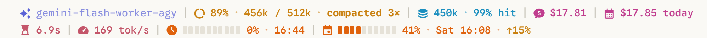
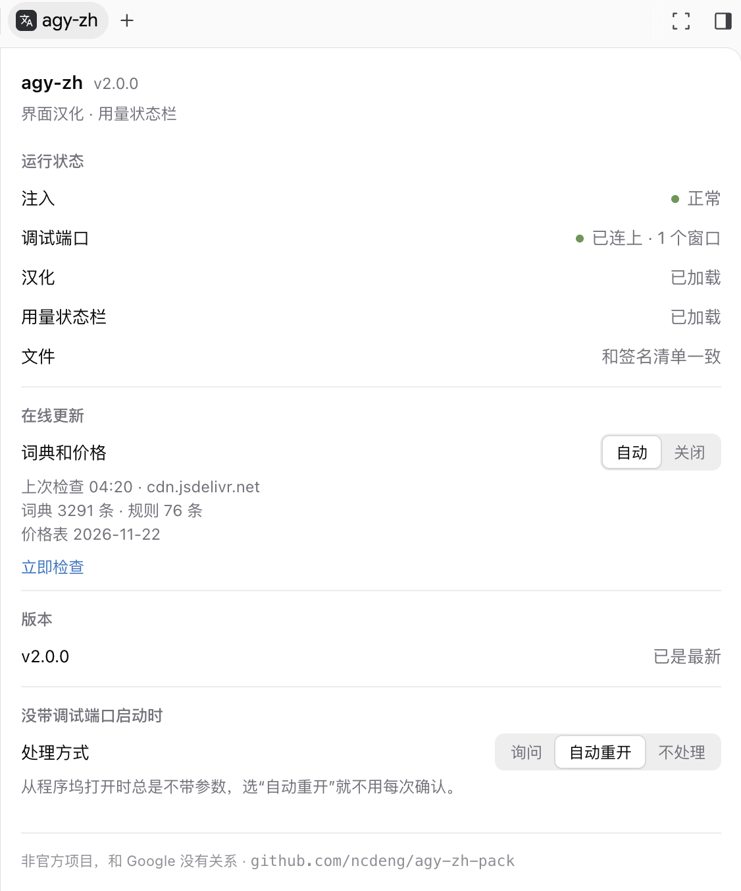

<div align="center">

# agy-zh

[简体中文](README.md) | [English](README.en.md)

**Antigravity 桌面版的非官方中文插件（Windows / macOS）**

界面汉化 · 输入框上方的用量状态栏 · 可选配色 · 签名后一键更新

[](https://github.com/ncdeng/agy-zh-pack/releases/latest)
[](LICENSE)




<sub>实际截图：一个长对话</sub>

</div>

> [!WARNING]
> 这是第三方项目，和 Google 没有关系。默认只改本机显示、只读本机数据；安装前请先读 [风险](#风险)。

> [!IMPORTANT]
> **v2.0 起，agy-zh 是一个 Antigravity 插件（v1.x 的名字是“中文美化包”）。** 装过 v1.x 的，下载 v2.0 安装包重新运行一次 `一键安装`：旧版的每日记录和外观设置会自动搬过来，旧版的开机自启会删掉。以后有新版本，在插件面板里点“更新”就行，不用再下载安装包。测试过的 Antigravity 版本是 2.34.0。

## 快速开始

**Windows**

1. 安装 Antigravity，并登录一次。
2. 从 [Releases](https://github.com/ncdeng/agy-zh-pack/releases/latest) 下载最新的 `agy-zh-pack-v<版本>.zip`，解压到任意位置（不要在压缩包里直接运行）。
3. 双击 `一键安装.cmd`。弹出“Windows 已保护你的电脑”时，点“更多信息”，再点“仍要运行”。
4. 安装中会问一个可选项：要不要用作者的配色。不确定就直接按回车（不用）。
5. Antigravity 开着的话不用关。如果它这次启动时没带调试端口参数，安装程序会问你，回车后关掉它，装完再带参数打开。
6. 以后请从开始菜单、桌面或任务栏的图标打开 Antigravity。安装程序给这些快捷方式加了启动参数。

**macOS**

1. 安装 Antigravity，并登录一次。
2. 下载并解压安装包。打开“终端”，输入 `bash` 和一个空格，把 `一键安装.command` 拖进终端窗口，按回车。
3. 安装中会问两件事：Antigravity 没带调试端口参数启动时要不要自动重开（推荐回车，选自动重开）；要不要用作者的配色。

装好以后，插件的面板在 Antigravity 右上角的“插件”菜单里，名字是“agy-zh”。想换配色：运行 `配色开关`。卸载：运行 `一键卸载`。请保留解压出来的文件夹。

## 默认状态

| 功能 | 默认 | 会不会改发给 Google 的内容 |
|---|---|---|
| 界面汉化 | 开 | 不会，只改本机显示 |
| 用量状态栏 | 开 | 不会，只读本机数据 |
| 作者的配色 | 关 | 不会，只改本机 Antigravity 的主题颜色 |
| 在线更新词典和价格 | 开 | 不会。每 6 小时向 GitHub 问一下本项目最新的提交，再从本项目的 GitHub 仓库（经 jsDelivr）下载词典和价格表，只是普通的下载请求，不上传任何数据。可以关掉，见 [在线更新](#在线更新) |
| 版本更新（代码） | 只在你点“更新”时 | 不会。装之前用作者的公钥校验签名，见 [版本更新](#版本更新) |
| 没带调试端口启动时 | Windows 先问你；macOS 按安装时的选择 | 不会。只关掉再带参数打开 Antigravity，见 [没带调试端口参数时](#没带调试端口参数时) |

缩放、字体、对比度一律不改。

## 功能

### 界面汉化

菜单、设置、按钮、提示文字换成中文（3273 条词典 + 76 条正则规则）。对话内容、代码、文件名不翻译。

有些东西刻意不翻：

- **Antigravity 自己的功能名**：Artifact、Turbo、Coordinator、Swarm 保留英文（例如“Turbo 模式”“Artifact 评论”），和官方文档、社区里的叫法一致，方便搜索。MCP、URL、SSH、token 这类术语也保留英文。
- **你自己或第三方起的名字**：对话标题、项目名、文件和路径、自动化名称、Coordinator 名称、分支 / 仓库 / worktree 名、SSH 主机、插件标题、MCP 服务器名，即使碰巧和词典里的词一样也不翻。
- **脱离上下文会翻错意思的单个词**：比如单独出现的 Plan（可能是“套餐”，也可能是“计划”）、Type、Space，保持英文。
- **报错信息**照常翻成中文，鼠标停在上面会显示英文原文，方便搜索和向官方反馈。

#### 只要状态栏、不要汉化

删掉插件目录里的 `i18n/zh-CN.json`（插件目录见 [安装程序做了什么](#安装程序做了什么)），再在 Antigravity 里按一次 `Ctrl+R`（macOS 是 `Cmd+R`），界面就恢复英文，状态栏照常显示。这时插件面板的“文件”一行会显示有 1 个文件和签名清单不一致，这是正常的。重新安装或更新版本会把这个文件装回来。

### 用量状态栏

输入框上方固定两行，每一项是“彩色图标 + 同色文字”。状态栏上的字和 ccline 一样用英文，鼠标停在任何一项上会显示中文的详细说明。配色、外形等可以换，见 [外观](#外观)。

| 行 | 显示示例 | 含义 |
|---|---|---|
| 第一行 | `gemini-flash-worker-agy` | 模型：界面上的名字，加上接口实际返回的模型名。Gemini 模型两者对不上时标黄 |
| | `89% · 456k · ↻3×` | 上下文：图标是随用量变满的圆环，后面是已用比例和已用 token。被自动压缩过的对话后面多一个浅黄小徽章，数字是压缩次数。悬停说明里有上限、进度条，以及 Antigravity 给出的各部分各占多少 token 和百分比、还剩多少空间（Free space），第几步压缩的也在这里 |
| | `99% hit` | 缓存：最近一次调用的缓存命中率；从缓存读了多少 token 看悬停说明 |
| | `$17.81` | 这个对话累计花费（含子代理）。悬停可以看最近一次调用的输入、缓存、输出 token 数和各自的金额 |
| | `$17.85 today` | 今天累计花费（本地 0 点起，所有对话）。点一下打开 [每日用量面板](#每日用量面板) |
| | `running` | 正在生成。没在生成时这一格留着空位，所以开始和结束生成时状态栏不会换行跳动；窗口窄时这一格先缩，不会挤到下一行 |
| 第二行 | `6.9s` | 首字时间 |
| | `169 tok/s` | 生成速度 |
| | `0% · 16:44` | 5 小时额度：已用比例（进度条）、重置时间 |
| | `41% · Sat 16:08 · ↑15%` | 每周额度：已用比例、重置时间、比匀速用完快（↑）或慢（↓）多少 |
| 子代理 | `├ research · Paper Reviewer … ● 1m05s` | 每个子代理单独一行，前面用 `├` `└` 连成树，几行的各列上下对齐。依次是：子代理类型和任务、模型、上下文、缓存命中、这个子代理自己的花费、状态。状态是 `● 已运行时间`、`● waiting`（在等你批准）或 `✓ done 用时 · N steps`；悬停看它正在做哪一步和最近几步。跑完约 10 秒后收起。打开子代理窗口时，显示那个子代理自己的数据 |

外观借鉴 Haleclipse（哈雷）的 [CCometixLine](https://github.com/Haleclipse/CCometixLine)（ccline，Claude Code 的状态栏工具）的 cometix 主题：两行显示、彩色图标配同色文字、`|` 分隔各项、`·` 连接同一项里的数字、额度带进度条。本项目没有用它的代码，状态栏是为 Antigravity 重新写的。

#### 外观

点 `$x today` 打开 [每日用量面板](#每日用量面板)，再点右上角的 `theme`。上面是配色画廊，每张卡片是你当前状态栏的实时副本，点一下就换；下面是其他选项。选了马上生效。

| 选项 | 可选值 | 默认 |
|---|---|---|
| 配色（palette） | Cometix、Catppuccin、Tokyo Night、Rosé Pine、Gruvbox、Nord、Dracula、Mono（单色） | Cometix（本项目自己的配色） |
| 外形（style） | `plain` 纯文字、竖线分隔；`pill` 每项一个圆角底色块；`powerline` 箭头色块 | `plain` |
| 额度进度条（bars） | `thin` 细条；`cells` 10 格；`ring` 小圆环；`none` 不画 | `thin` |
| 信息密度（detail） | `compact` 上下文不写上限、缓存只写命中率；`full` 上下文带上限、缓存带读到的 token 数 | `compact` |
| 图标（icons） | `material` 实心图标；`outline` 线条图标；`unicode` 普通字符（不用在线图标字体）；`off` 不显示 | `material` |
| 单项图标（swap） | 每一项有一个备选图标，点一下在默认和备选之间切换。比如模型可以换成彗星，生成速度可以换成三档仪表（指针指向慢 / 中 / 快：低于 30、30～60、高于 60 tok/s） | 全部用默认图标 |

- 每套配色都有浅色和深色两版，跟着 Antigravity 的浅色 / 深色自动切换。色值取自各配色方案公开的定义（见 [致谢](#致谢)）。Nord 官方只有深色，浅色版把偏淡的几种颜色调深了。
- 选择存在数据目录的 `look.json`，插件 30 秒内保存，并同步到其他窗口。想回到默认，在 Theme 页右上角点 `reset`；也可以关掉 Antigravity 后删掉这个文件。
- 分层的思路（配色、外形、进度条字形、详略）和“仪表代替图标”（上下文的图标画成随用量变满的圆环）参考 ccline v2。本项目没有用它的代码。

#### 每日用量面板

点状态栏上的 `$x today`，状态栏上方会弹出一个面板，宽度和输入框一样，高度用满状态栏上方的空间。再点一次、点面板外面或按 `Esc` 关掉。右上角显示当前登录的账号（邮箱打码，比如 `ab***12@gmail.com · Ultra`）和 `theme` 按钮（打开 [外观](#外观) 设置）。

- **顶部四格**：今天的花费、调用次数、token 总数、缓存命中率。
- **柱状图**：最近 7 天或 30 天每天的折算花费，按模型分颜色。鼠标停在柱子上看当天的明细。
- **表格**：每天一行，有花费、对话数、调用数、token 总数、输入 / 缓存 / 输出 token、缓存命中率，以及当天用掉了多少个百分点的每周额度（Gemini 组和 Claude 组分开）。
- **调用明细**：点表格里的某一天，打开那一天每次模型调用的明细（今天和以前的天都可以）：时间、对话、模型、花费、输入、输出、缓存读、缓存写、命中率、生成速度、首字时间、总耗时。最新的在上面，最多列 600 行，合计按全部调用算。开着的时候每 30 秒在后台刷新一次，有新数据才换内容，不会闪，也不会跳回顶部。点 `← usage` 回去。
- **底部**：这段时间的合计（花费、token）和日均；每组每周额度一行，见下面的“每周额度预估”。

数据存在数据目录的 `usage-history.json`，保留 90 天，只存金额、调用数、token 数和额度比例，不存对话内容。额度记录按账号分开记，换号以后不会混在一起；文件里只存打码的邮箱和一个账号编号（邮箱的哈希），不存完整邮箱。

**每周额度预估**（每组一行，比如 `Gemini weekly · 3% used · cap ≈ $952 / 2.15B tok (rough) · resets 11-29 09:41 · est 45% at reset (rough)`）：

- `cap ≈`：这一周（重置时间往前 7 天到重置时间）本机的折算花费和 token，除以这一周的已用比例，估出整周额度大约相当于多少钱、多少 token。
- `est … at reset`：照最近的用量速度，到重置时大约会用到多少；照这个速度会提前用完的，改成 `full` 加预计用完的时间。速度取这一周的平均和最近 24 小时（至少有 6 小时的读数）两种。额度读数存在 `quota-samples.json`，保留 8 天。
- 两个数都标 `(rough)`：已用比例本身会来回起伏，刚开始一周、用得很少时误差很大。悬停看算法和剩余额度。

每周额度按每个周期的净变化算：当天最后看到的已用比例，减去当天开始时的已用比例；当天换了周期，就分段相加。原因是已用比例在同一个周期里会来回起伏（实测正在生成时，6 分钟里从 1.699% 降到 1.594%），v1.4.x 只累计上涨的部分，会把回落后的再上涨重复算进去，当天用量偏高。v1.5.0 升级后会自动按新方法重算以前的每周额度记录。

- Antigravity 没开着时用掉的额度（比如用 agy CLI），会算到下次观察到的那一天。
- 额度是按账号算的。如果这个号开了 Google 家庭组共享，或者在别的电脑上也在用，额度里会包含别人的用量。这时 `cap ≈` 会偏低（别人的用量涨了额度，却没有算进本机的花费），`est` 会偏高。

装上以后，插件会补算以前的天数，只补一次：只读打开 Antigravity 自己的对话库（Windows 是 `%USERPROFILE%\.gemini\antigravity\conversations\*.db`，macOS 是 `~/.gemini/antigravity/conversations/*.db`），读出每次调用的时间、模型和 token 数，按日期归到每一天，钱按状态栏的单价表算。补算的天没有额度记录（以前没人记过）。每次调用按它自己的时间归日。v1.5.x 按“这一轮开始的时间”归日，跑过 0 点的一轮会整轮记到前一天（实测一天少记了 349 次调用）；v1.6 起升级后会自动重算一次以前补算的天数。补算用到 Node.js 内置的 `node:sqlite`，插件用的是 Antigravity 自带的 Node（24.x），满足要求。补算用的是 Antigravity 内部的存储格式，它改了格式就补不出来，不影响其他功能。

#### 费用怎么算

费用 = token 数 × Google / Anthropic 公开的 API 标准价，折成美元。**这是折算值，不是实际扣费**：订阅是按额度扣的。

<details>
<summary>单价表（美元 / 百万 token）</summary>

| 模型 | 输入 | 缓存读取 | 输出（含思考） |
|---|---|---|---|
| Gemini 4 Neon（含 Orchestrator (Neon) 的规划） | $3 | $0.15 | $15 |
| Gemini 4 Carbon / Argon（含 Orchestrator 的规划） | $2（12-01 起 $4） | $0.10（12-01 起 $0.20） | $10（12-01 起 $20） |
| Gemini 4 Hydrogen（含 Orchestrator 的执行模型） | $1.50 | $0.075 | $7.50 |
| Gemini 3.8 Flash | $0.75（2027-01-01 起 $1.50） | $0.075（同日起 $0.15） | $3.75（同日起 $7.50） |
| Claude Opus 5.5 | $4 | $0.20 | $20 |
| Claude Sonnet 5.5 | $2 | $0.10 | $10 |

- Claude 的缓存写入按 5 分钟缓存计：Opus 5.5 $5、Sonnet 5.5 $2.50。
- `gemini-4-hydrogen-tiered-high`（浏览器子代理用的）官方价格页没有，按 Gemini 4 Hydrogen 的标准价估。
- GPT-OSS 120B 没有单价，不计入。
- 出处：Google AI Studio 价格页（2026-11-16；Neon 2026-11-19）、Anthropic 官方价（2026-11-03）。Claude 在 Antigravity 里经 Google Vertex 调用，实际价格可能不同。
- 单价默认用在线价格表 `data/prices.json`（见 [在线更新](#在线更新)）。鼠标停在 `$x today` 上可以看用的是在线的还是内置的。内置的单价写在 `statusbar.js` 的 `PRICES` 里，关掉在线更新或下载不到时用它。
- 今天的花费：今天动过的对话里，0 点以后的调用加起来。每个对话今天的金额记在数据目录的 `cost-day.json`，Antigravity 重启后不会清零；过了 0 点自动重新开始。

</details>

### 插件面板



Antigravity 右上角的“插件”菜单 → agy-zh。面板的颜色和字体跟着 Antigravity 当前的主题走。

- **运行状态**：注入是否正常、调试端口有没有连上（连上了几个窗口）、汉化和状态栏有没有加载、插件目录里的文件和签名清单是否一致。这次启动没带调试端口参数时，这里有一个“带参数重启 Antigravity”按钮。
- **在线更新**：词典和价格的在线更新开关、上次检查的时间和地址、在线词典的条数、价格表的日期，以及“立即检查”。
- **版本**：现在的版本、有没有新版本。有新版本时显示“更新”按钮，见 [版本更新](#版本更新)。
- **没带调试端口启动时**：询问 / 自动重开 / 不处理，见 [没带调试端口参数时](#没带调试端口参数时)。

面板只显示状态和这几个开关，不显示邮箱等个人信息。面板的接口只听本机 `127.0.0.1`，要带 Antigravity 给的令牌才能调用。

### 在线更新

Antigravity 更新后会加新的界面文字，Google 也会调价。为了不用每次都发新版，插件每 6 小时从本项目的 GitHub 仓库下载几个数据文件：

| 文件 | 内容 | 谁来更新 |
|---|---|---|
| `i18n/zh-CN.json`、`i18n/zh-CN.rules.json` | 词典和规则 | 作者补了汉化就推上去 |
| `data/prices.json` | 每个模型的单价 | GitHub Actions 每天按 Google AI Studio 和 Vertex AI 的官方价格页核对，价格变了才提交（`tools/update-prices.mjs`） |
| `data/meta.json` | 最新的版本号 | 发版时改 |

- **这里只下载数据。** 词典和规则只被当作文字填进界面（不当 HTML），价格只是数字。代码的更新要你在插件面板里点了才装，见 [版本更新](#版本更新)。
- **下载走 Antigravity 自己的网络。** 请求从 Antigravity 的页面里发出，用的是 Antigravity 的网络和代理设置，不带 cookie 和 Referer。地址依次试 `cdn.jsdelivr.net`、`fastly.jsdelivr.net`、`gcore.jsdelivr.net`、`raw.githubusercontent.com`，记住上次能用的那个。
- **按提交下载。** 插件先向 GitHub（`api.github.com`）问一下仓库 main 分支最新的提交，再按这个提交下载所有文件。按提交下载的内容不会变，哪个地址给的都一样新。问不到 GitHub 时（比如被限流），就向所有地址取 `data/meta.json`，用内容最新的那个地址。v2.0.1 及以前只按分支下载，jsDelivr 的某个节点缓存过时时，会好几个小时都拿到旧词典，也看不到新版本提示；v2.0.2 修好了。
- **先校验再用。** 格式不对、条数比安装包自带的少两成以上（比如只下载到半截）、单价超出范围的文件不用，继续用原来的。下载失败 30 分钟后重试。
- 在线词典覆盖自带词典里的同名条目，自带的其他条目照用。删掉了自带词典（只要状态栏）时，在线词典也不用。在线价格表里有的模型用在线的价，没有的用内置的价。
- 改了译文的文字马上换上；在线词典里没有了的条目恢复英文。
- 下载到的文件存在数据目录的 `remote/` 里，Antigravity 重启后照用。装了新版本以后，存着的词典先不用，等下一次下载（插件启动约 1 分钟后）。v1.7.0 有一个问题：重启后存着的价格表和版本信息读不出来，要等下一次下载（最多 6 小时）才恢复；v2.0 修好了。
- **关掉**：插件面板 → 在线更新 → “词典和价格”选“关闭”；或者每日用量面板 → `theme` → 最下面的 `updates` 选 `off`。两处是同一个开关。关掉以后不再联网，词典和价格只用插件自带的，也不检查新版本。

### 版本更新

有新版本时，插件面板的“版本”一节和每日用量面板右上角会提示。在插件面板里点“更新”：

1. 从那个版本的标签下载签名清单 `plugin-manifest.json`（jsDelivr 的 `@v<版本>`，备用 raw.githubusercontent.com），用插件里的作者公钥校验 Ed25519 签名。签名不对就停下，一个文件都不下载。
2. 按清单下载每个文件，逐个核对 sha256 和大小。任何一个对不上就停下，插件目录不动，下载了一半的文件删掉。
3. 全部对上以后，把现在的文件备份到数据目录的 `backup/v<现在的版本>/`，再逐个替换。替换中途出错就用备份恢复。
4. 插件自动重启（约 2 秒），Antigravity 不用关，已打开的窗口会重新注入。

- 签名用的私钥只在作者电脑上，不在 GitHub 上。所以 GitHub 账号或仓库被人改了，也装不进没签过名的代码。公钥指纹是 `246b2f1a387df2c5`。
- 插件启动时会核对插件目录里的文件和签名清单，结果显示在面板的“文件”一行。
- 更新的下载和词典一样，从 Antigravity 的页面里发出；没有打开的窗口时由插件直接下载。

### 可选：作者的配色

Claude 风格的暖白配色，默认不用。

| 主题 | 背景 | 文字 | 强调色 |
|---|---|---|---|
| 浅色 | `#FAF9F5` | `#141413` | `#D97757` |
| 深色 | `#262624` | `#FAF9F5` | `#D97757` |

- 只改主题颜色，不改缩放、字体和对比度。
- 换上前，原来的颜色记在数据目录的 `originals.json`，换回或卸载时按它恢复。
- 一键安装时会问一次（回车 = 不用）；装好以后运行 `配色开关` 换上或换回。
- 颜色存在 Antigravity 自己的设置文件里（`~/.gemini/config/config.json` 的 `customThemeSeedsLight` / `customThemeSeedsDark`）。Antigravity 运行时会把这个文件写回去，所以换颜色时要先关闭它，改完会自动重新打开。

### 上下文上限

v1.1.0～v1.3.0 有一个可选的“解锁 512K 上下文”，2026-11-20 起去掉了。原因是官方默认的上限已经提高：在 Antigravity 2.33.0 上关掉解锁、新开对话，Gemini 4 Neon 和 Gemini 4 Carbon 是 512k，Claude Opus 5.5 是 840k。这时再补 512000，对 Gemini 没有作用，反而会把 Claude 的上限从 840k 压到 512k。装过旧版、打开过解锁的，装 v2.0 时旧设置会一起去掉。

## 没带调试端口参数时

插件要靠 Antigravity 的 Chromium 远程调试端口改界面。Antigravity 2.33.0 起，只有带启动参数 `--remote-debugging-port` 打开时才有这个端口。

- **Windows**：安装程序给开始菜单、桌面、任务栏上的 Antigravity 快捷方式加上 `--remote-debugging-port=0`（`0` = 随机端口），卸载时去掉。只改目标是 `%LOCALAPPDATA%\Programs\antigravity\Antigravity.exe` 的快捷方式。Antigravity 自动更新后可能重写快捷方式，插件发现端口没开时，每 2 分钟检查一次，把参数补回去。
- **macOS**：从程序坞或启动台打开 Antigravity 时总是不带参数。
- **这次启动没带参数时**：插件约 20 秒后发现，按面板里“没带调试端口启动时”的设置处理：
  - **询问**（Windows 默认）：弹框问要不要现在重启 Antigravity。点“确定”就重启，点“取消”这次就不再问。
  - **自动重开**（macOS 安装时推荐）：不问，直接重启。
  - **不处理**：什么都不做，界面保持英文。
- 询问或重开之前，插件先查正在运行的 Antigravity 是怎么启动的。确实没带参数才询问或重开；带了参数、只是端口一时连不上（例如电脑很忙），插件不处理，只在日志里记一行。v2.0.0 没有这一步，会误重启带了参数的 Antigravity，v2.0.1 修好了。
- 重启的做法：先正常关闭 Antigravity，几秒内没退出就强制结束，再带参数打开。对话记录会保留，正在运行的任务会被打断。实测从关闭到重新注入约 6 秒。重新打开时只带调试端口参数：你自己在快捷方式上加的其他启动参数这次不会带上。
- 想手动检查 Windows 快捷方式：`powershell -ExecutionPolicy Bypass -File "%USERPROFILE%\.gemini\config\plugins\agy-zh-pack\debug-port.ps1" -Mode check`。

## 风险

请先读完这一节，再决定用不用。

- Antigravity 附加服务条款第 6 条规定：不得滥用、损害、干扰服务，包括 “using the Service in connection with products not provided by us”。违反条款可能导致 Antigravity 和 Gemini CLI 账号被暂停或终止。本项目是第三方工具，作者不能保证使用它不违反条款。
- 本项目只改本机的界面显示，状态栏只读取本机数据，不改发给 Google 的内容。
- 插件由 Antigravity 在后台启动，用 Antigravity 自带的 Node 运行，约占 80～120 MB 内存。
- 在线更新会从本项目的 GitHub 仓库下载词典和价格表。万一仓库被人篡改，界面上可能出现被改过的文字（不会执行代码，也拿不到你的数据）。介意的话在插件面板里把在线更新关掉。
- 版本更新会下载并运行新代码，但只装作者签过名的版本（见 [版本更新](#版本更新)）。如果作者的私钥泄露，别人就能签出“作者发布的”版本。
- 没带调试端口参数时的自动重开会关掉 Antigravity，正在运行的任务会被打断。不想这样，在面板里选“询问”或“不处理”。
- 本项目依赖 Antigravity 内部的页面结构和接口。Antigravity 更新后，部分功能可能失效，新加的界面文字会先显示英文。
- 启动参数会在本机 `127.0.0.1` 打开一个调试端口（2.33.0 以前的 Antigravity 本来就默认打开）。本机上的其他程序可以通过这个端口控制 Antigravity 窗口。介意的话请不要使用本项目。

## 安装程序做了什么

安装脚本用 Antigravity 自带的 Node 运行（Windows 的 `Antigravity.exe`、macOS 的 `Antigravity Helper`），不用另装 Node.js。

1. 核对安装包：按 `plugin-manifest.json` 校验作者签名和每个文件的 sha256，对不上就不装。
2. Antigravity 开着但这次没带调试端口参数：问过你以后先关掉它，装完再带参数打开。
3. 从 v1.x 迁移：停掉旧的注入程序，删掉开机自启（Windows 的计划任务 `AgyZhPack` 和“启动”文件夹里的脚本，macOS 的 LaunchAgent），把每日记录、外观、额度读数、配色原值、`style.css` 搬到数据目录，删掉 Windows 上旧的安装目录 `%LOCALAPPDATA%\AgyZhPack`。macOS 上从源码运行的旧版，源码文件夹不动。
4. 把插件复制到**插件目录** `~/.gemini/config/plugins/agy-zh-pack`（Windows 是 `%USERPROFILE%\.gemini\config\plugins\agy-zh-pack`）。Antigravity 开着时几秒内会自动启动插件（macOS 实测）；没有启动的话，重启一次 Antigravity。
5. Windows：给 Antigravity 的快捷方式加启动参数。macOS：问 Antigravity 没带参数启动时要不要自动重开。
6. 问要不要用作者的配色（默认不用）。

**数据目录**是 `~/.gemini/antigravity/plugin_data/agy-zh-pack`（Windows 是 `%USERPROFILE%\.gemini\antigravity\plugin_data\agy-zh-pack`）。插件更新时插件目录会整个换掉，数据放在外面，不受影响。里面有：`cost-day.json`（今天的花费）、`usage-history.json`（每天的用量）、`quota-samples.json`（额度读数）、`look.json`（状态栏外观和在线更新开关）、`settings.json`（没带参数启动时的处理方式）、`originals.json`（配色原值）、`remote/`（在线更新下载到的文件）、`inject.log`（日志）、`relaunch.log`（重开的记录）。

不改缩放、字体、对比度。配色只在你选择“作者的配色”时才改。

## 卸载

运行 `一键卸载`（Windows 双击 `一键卸载.cmd`；macOS 在终端里用 `bash` 运行 `一键卸载.command`）：

- 去掉快捷方式上的启动参数，删掉插件目录。Antigravity 开着时会在几秒内停掉插件；刷新一下窗口就变回英文。
- 用过作者的配色的，会问要不要恢复成原来的颜色（要先关闭 Antigravity，改完再打开）。
- Antigravity 关着时，顺便删掉它的设置文件里给本插件记的条目。
- 最后问要不要连数据目录一起删。选保留的话，以后重装还能接着用以前的每日记录。
- 插件目录被占着删不掉时（很少见），会提示你关掉 Antigravity 以后手动删。

请保留解压出来的文件夹，卸载、切换配色时都要用。

<details>
<summary>装过旧版 v1.0.0 的注意</summary>

v1.0.0 安装时直接改了外观（缩放 131%、强对比度、系统字体、暖白配色）。从 v1.1.0 起，缩放、对比度、字体不再改，配色改成可选：

- 升级安装时，旧版改的缩放、对比度、字体保持不动；配色那一问会显示“现在用的是作者的配色”，输入 n 就能换回原来的颜色。
- 想全部恢复成安装旧版之前的样子：运行 `一键卸载` 时选择恢复，再重新安装。

</details>

## 测试情况

| Antigravity 版本 | 测过的内容 | 日期 |
|---|---|---|
| 2.34.0 | v2.0.2（macOS 15.7.9 真机）：在线更新记住的地址是缓存过时的 `gcore.jsdelivr.net`（按分支取到的还是 1.7.0 和旧词典）时，按提交下载拿到了最新的版本号和词典。选地址的逻辑另有 18 项单元测试（GitHub 被限流、回答不对、地址取不到、内容是半截、全部失败等） | 2026-11-23 |
| 2.34.0 | v2.0.1（Windows 11、macOS 15.7.9 真机）：判断 Antigravity 是怎么启动的（带了参数、没带参数、没在运行三种，用真实的 Antigravity 和假程序测）；端口连不上但 Antigravity 带了参数时不重开、日志写明原因；确实没带参数时照常自动重开（演练模式，没有真的重启） | 2026-11-23 |
| 2.34.0 | v2.0（Windows 11 真机）：从作者自己的开发版迁移到插件（数据手动复制）以后，插件启动、注入、汉化、状态栏、插件面板（跟着 Antigravity 的配色）、在线更新都正常；不带调试端口启动：自动重开（约 25 秒后发现、6 秒内重开并重新注入）、弹框询问后重开、Antigravity 开着但没带参数时运行安装包（关闭 → 安装 → 带参数重新打开）；覆盖安装后插件自己重启；一键更新（用本机服务器模拟仓库，测试版用真钥匙签名）：正常更新约 0.2 秒装完并重启插件，清单被改过但没重签时拒绝、一个文件都不下载，有文件被改时拒绝、插件目录不变；隔离目录里测了从 v1.x 迁移安装和卸载的 5 种情况（关着 / 开着 Antigravity、恢复 / 保留配色和数据、插件目录被占用），27 项检查全部通过；子代理行各列对齐；调用明细定时刷新不再闪；Windows 的重开脚本重写后，在插件里用演练模式（只记录、不关 Antigravity）测了资源管理器和 WMI 两条路，接手的脚本都不在 Antigravity 的作业对象里；用重写后的脚本真机重开一次：点“重开”后约 4 秒新窗口带参数启动、约 6 秒重新注入，这次发现只剩一个进程时等待会提前结束（PowerShell 把一个元素的数组拆成单个对象），已修，修后用假程序测了没有进程、1 个进程晚退出、3 个进程不退出三种情况，修好后又真机重开一次：日志里主进程数是 1，12 个进程全部退出后才启动，点“重开”后约 4 秒新窗口带参数启动、约 8 秒重新注入，上一次留下的标记文件按设计清掉了；性能改动后在无界面 Edge 里对比：3 个子代理在跑时状态栏每秒的主线程耗时从约 4.4 ms 降到约 2 ms，回复流式输出时翻译器的额外耗时约减半。**没测**：Windows 真机上全新安装时 Antigravity 开着能不能马上发现插件（这次装的时候 Antigravity 关着）、真机卸载、从标准 v1.x 安装（`%LOCALAPPDATA%\AgyZhPack`）的真机迁移 | 2026-11-23 |
| 2.34.0 | v2.0（macOS 15.7.9 真机）：从源码运行的旧版（LaunchAgent）迁移到插件，放进插件目录几秒内自动启动；插件面板；一键更新的三种情况（同上）；没带参数启动时自动重开（重开脚本立即脱离插件进程，关掉后带参数重新打开）；11-23 用安装包覆盖安装新版（改名 agy-zh、状态栏和翻译器的性能修改），注入、汉化、状态栏、插件面板正常，再测一次自动重开：点“重开”后约 4 秒带参数重新打开、约 12 秒重新注入。**没测**：卸载、配色开关、弹框询问、Antigravity 深色主题下的插件面板（只在本机预览里看过） | 2026-11-23 |
| 2.34.0 | v1.7（Windows 11 真机，用本机服务器模拟仓库）：四个文件从 Antigravity 页面里下载（不带 cookie 和 Referer），校验后存进 `remote/`；在线词典的条目生效；`updates` 关掉后回到自带词典和内置价格，打开后 3 秒内重新检查；版本号改成 1.7.1 时面板显示新版本提示；词典被截成 100 条时拒收、继续用原来的；规则里一条写错的正则只跳过这一条；服务器停掉时记下错误、继续用存着的数据。翻译器换词典重翻：浏览器里 17 项测试全部通过。推到 GitHub 以后：Windows 和 macOS 都从 `cdn.jsdelivr.net` 取到四个文件并通过校验；GitHub Actions 上 update-prices 取到两个价格页、解析出 17 个模型、没有变化也没有问题，purge-cdn 清四个文件的缓存都返回 200。**没测**：价格真的变了时的自动提交、出问题时的自动开 issue（只离线模拟过） | 2026-11-22 |
| 2.34.0 | v1.6（Windows 11 真机）：子代理树形行、压缩徽章、上下文悬停里各部分的百分比、`running` 在窄窗口不换行；Theme 页的四种图标和每一项的备选图标；每日面板的账号、顶部四格、token 列、调用明细（11-18 共 1101 次、$69.24）、每周额度的 `cap` 和预估；补算 v2 读了 79 个对话库，七天的调用次数逐天和调用明细一致。macOS 真机：账号显示、按账号分开记额度历史、面板正常 | 2026-11-22 |
| 2.34.0 | v1.5.x：8 套配色、3 种外形、4 种进度条、图标开关、Theme 页（Windows 和 macOS 真机，macOS 含深色主题）；每周额度改成按周期净变化（用真实历史离线重算，11-22 从 +7.24% 改成 +1.59%）；悬停提示框（issue #2）；2.34.0 新增界面文字的汉化 | 2026-11-22 |
| 2.33.0 | 官方默认上下文上限（Gemini 512k、Claude Opus 5.5 840k）；去掉 512K 解锁；每日用量面板；补算（73 个对话库、4270 次调用，今天和实时记账一致）；汉化（补了 301 条文字和 4 条规则）；快捷方式参数 | 2026-11-19～20 |
| 2.32.1 及以前 | 状态栏各项、费用、汉化、旧版的 512K 和上下文开关、安装和配色开关（隔离目录） | 2026-11-04～16 |

已知的汉化不足：

- 有些句子由几段文字拼成，中间夹着文件名或链接。这类句子按段翻译，语序不一定自然；只剩一两个虚词、单独读不通的片段保持英文。
- 设置页的部分说明（比如界面布局的模式名、内置技能的说明）是 Antigravity 后台下发的，不在前端代码里。后台改了文字，这些地方会先变回英文。

## 原理

- 插件 = 插件目录里的 `plugin.json` + 一个 sidecar（`sidecars/core/sidecar.json`）。Antigravity 的后台（`language_server`）发现插件后，用 Antigravity 自带的 Node 启动 sidecar（`sidecars/core/main.mjs`）；sidecar 退出后约 1～2 秒会被重新拉起，插件目录被删掉时会被停掉。
- sidecar 里跑注入程序 `inject.mjs`：每 3 秒检查一次 Antigravity 的调试端口（端口号在 Antigravity 写的 `DevToolsActivePort` 文件里），发现主窗口后，用 Chrome DevTools Protocol 注入翻译器和状态栏脚本。不修改 Antigravity 的安装文件，Antigravity 自动更新后仍然有效。同一时间只有一个注入程序在工作（本机单实例锁）。
- sidecar 还提供插件面板（`lib/panel.mjs`，只听 `127.0.0.1`）、没带参数启动时的重开（`lib/relaunch.mjs`）和版本更新（`lib/update.mjs`）。
- 重开：sidecar 是 Antigravity 的子进程，Antigravity 关掉时它也会被关掉，所以重开由一个脱离 Antigravity 运行的脚本来做。Windows 上是数据目录里的 `relaunch-antigravity.ps1`，交给资源管理器启动（不行再用 WMI）；macOS 上是用 `nohup` 在后台运行的 shell 脚本。脚本请 Antigravity 正常关闭，10 秒后还没退出就强制结束，再带 `--remote-debugging-port=0` 打开。每一步记进 `relaunch.log`。
- 状态栏在页面里包一层 `fetch`，旁听应用和本机后台之间的 grpc-web+json 数据，不改应用发出的请求。另外，它向本机后台查几个只读接口：额度、当前登录的账号（邮箱和订阅档次；邮箱只在页面里用来算账号编号和打码显示，不写进文件）、实际模型名、子代理运行状态和步骤、每次调用的 token 用量和调用时间（算费用和调用明细）。
- 注入程序每 30 秒把页面里今天的花费存进 `cost-day.json`，并从 `~/.gemini/antigravity/brain/` 找出今天动过的对话，再把对话库文件夹（`conversations`）里最近 32 天的对话 ID、创建时间和修改时间交给状态栏（后台的对话列表只列一部分对话），所以 Antigravity 重启后今天的金额不会丢。只存对话 ID、金额和按模型的调用数、token 数。同时把当天的汇总和额度变化写进 `usage-history.json`，再把最近 31 天交给状态栏的每日用量面板。
- 默认不写 Antigravity 的设置文件。只有两种情况会写：你选择作者的配色（或换回），会改 `~/.gemini/config/config.json` 的两组主题颜色；卸载时选择恢复，会按记下的原值改回这个文件（装过旧版 v1.0.0 的还有 `%APPDATA%\Antigravity\app_storage.json`）。卸载时还会删掉 Antigravity 给本插件记的条目。
- 联网只有三处：从 Google Fonts 加载状态栏的图标；[在线更新](#在线更新) 从 jsDelivr（或 raw.githubusercontent.com）下载本项目仓库里的数据文件（可以关掉）；在插件面板里点“更新”时下载新版本。

<details>
<summary>从源码运行、打包和发版</summary>

**从源码运行**（不装成插件）：需要 Node.js 22.13 / 23.4 或更高版本（用到内置的 `WebSocket`、`fetch` 和 `node:sqlite`）。

```bash
node inject.mjs
```

- 这样运行时，数据文件放在 `inject.mjs` 同一个文件夹里。已经有一个注入程序在跑（包括装好的插件）时，新启动的会自动退出。
- Antigravity 要带 `--remote-debugging-port=0` 启动。Windows 先运行一次 `powershell -ExecutionPolicy Bypass -File debug-port.ps1` 给快捷方式加上参数；macOS 运行 `./macos/launch-agy.command`（或 `open -a Antigravity --args --remote-debugging-port=0`），见 [macos/README.md](macos/README.md)。
- 改了 `statusbar.js` 或 `i18n` 下的文件后，已打开的窗口会自动更新，不用重启。改了 `inject.mjs` 要重启注入程序。
- 想给页面加自己的样式（比如换回复字体），在数据目录（从源码运行时是 `inject.mjs` 同一个文件夹）放一个 `style.css`，注入程序会自动加载；没有这个文件就不改任何样式。
- 改了 `i18n/translator.js` 的逻辑，要把里面的 `VERSION` 加 1，已打开的窗口才会换用新翻译器。
- 如果注入程序在 Antigravity 打开很久以后才启动，状态栏会提示 `Press Ctrl+R to reload this window`，按一次 Ctrl+R 刷新窗口就好。

**发版**（需要作者的签名私钥）：

1. 把 `plugin.json` 的 `version` 和 `inject.mjs` 的 `PACK_VERSION` 改成新版本（两处要一致）。
2. `node tools/release.mjs sign`：按 `tools/plugin-files.mjs` 的清单生成并签名 `plugin-manifest.json`。
3. `node package/build.mjs`：核对签名清单，生成 `dist/agy-zh/` 和同名 zip。
4. 提交（包括 `plugin-manifest.json`），打标签 `v<版本>` 并推上去。一键更新从 jsDelivr 的 `@v<版本>` 取文件，所以标签里必须有签好名的清单。
5. 在 GitHub Releases 发布，zip 改成英文名 `agy-zh-pack-v<版本>.zip`（GitHub 会去掉文件名里的中文）。
6. 把 `data/meta.json` 的 `latest`、`date` 改成新版本，推到 main。装着旧版本的用户这时才会看到新版本提示。

私钥用 Windows DPAPI 加密存在作者电脑上（`tools/release.mjs keygen` 生成）。`node tools/release.mjs export <文件>` 备份成只有当前账号能读的文件，`node tools/release.mjs import <文件>` 在重装系统或换电脑后恢复。私钥丢了就签不了新版本，已安装的插件也收不到更新。

</details>

<details>
<summary>文件说明</summary>

| 文件 | 作用 |
|---|---|
| `plugin.json` | 插件的名字、版本、图标 |
| `sidecars/core/sidecar.json` | sidecar 的启动方式（Antigravity 自带的 Node）和侧边栏面板 |
| `sidecars/core/main.mjs` | sidecar 入口：设好数据目录，启动注入程序、面板、重开检查；插件文件被换掉时自动重启 |
| `lib/panel.mjs` | 插件面板（网页和接口） |
| `lib/relaunch.mjs` | 没带调试端口启动时询问或自动重开 |
| `lib/update.mjs` | 版本更新：校验签名、下载、备份、替换；作者的公钥在这里 |
| `lib/remote-source.mjs` | 在线更新从哪个地址、按哪个提交下载（先问 GitHub 最新提交；问不到就用 meta.json 最新的地址） |
| `plugin-manifest.json` | 签名清单：版本、每个插件文件的 sha256 和大小、Ed25519 签名 |
| `assets/logo.svg` | 插件图标 |
| `inject.mjs` | 注入程序：连 Antigravity 的调试端口，注入下面几个文件；保存今天花费的账本；在线更新 |
| `debug-port.ps1` | 给 Windows 上的 Antigravity 快捷方式加、去启动参数 `--remote-debugging-port=0` |
| `statusbar.js` | 用量状态栏和费用估算（在页面里运行） |
| `i18n/translator.js` | 翻译器（在页面里运行） |
| `i18n/zh-CN.json` | 词典：界面英文原文 → 中文 |
| `i18n/zh-CN.rules.json` | 正则规则：相对时间、思考时长等带数字的文字 |
| `data/prices.json` | 在线价格表（GitHub Actions 每天按官方价格页更新） |
| `data/meta.json` | 最新版本号（发版时改） |
| `tools/plugin-files.mjs` | 插件包含哪些文件（签名、打包、安装都按它） |
| `tools/release.mjs` | 发版签名：生成钥匙、签名、校验、备份和恢复私钥 |
| `tools/update-prices.mjs` | 按官方价格页更新 `data/prices.json` |
| `.github/workflows/update-prices.yml` | 每天跑一次上面的脚本：价格变了就提交，出了问题就开 issue |
| `.github/workflows/purge-cdn.yml` | 推送了词典或 `data/` 以后，清掉 jsDelivr 上的缓存 |
| `package/app/setup.mjs` | 一键安装、卸载、配色开关 |
| `package/build.mjs` | 生成安装包 |
| `macos/` | 从源码运行时的 macOS 脚本（v1.x 的方式）；装插件请用安装包 |
| `assets/statusbar.png`、`assets/panel.png` | 本页的截图 |

数据目录里的文件见 [安装程序做了什么](#安装程序做了什么)。

</details>

## 致谢

- 状态栏的外观和英文写法借鉴 Haleclipse（哈雷）的 [CCometixLine](https://github.com/Haleclipse/CCometixLine)（ccline）的 cometix 主题；v1.5.0 的外观分层（配色、外形、进度条、详略）和上下文圆环参考 ccline v2。感谢哈雷做出这么好看的状态栏。
- 5 小时和每周额度的显示方式参考 agyline。
- 默认配色 Cometix 以 [Catppuccin](https://catppuccin.com)（浅色 Latte，深色 Mocha）为底。其他配色的色值取自各方案公开的定义：Catppuccin、[Tokyo Night](https://github.com/folke/tokyonight.nvim)、[Rosé Pine](https://rosepinetheme.com)、[Gruvbox](https://github.com/morhetz/gruvbox)、[Nord](https://www.nordtheme.com)、[Dracula](https://draculatheme.com)（浅色是官方的 Alucard）。
- 图标：Material Symbols 和插件图标用的 Material Icons “translate”（Apache License 2.0）。模型的备选图标（彗星）是 [Font Awesome Free](https://fontawesome.com) 6.7.2 的 meteor，许可 [CC BY 4.0](https://fontawesome.com/license/free)，版权 Fonticons, Inc.。

## 许可

本项目代码使用 MIT 许可，见 [LICENSE](LICENSE)。

Antigravity 是 Google 的产品。词典 `zh-CN.json` 的键是 Antigravity 的界面英文原文，用于匹配要翻译的文字。
