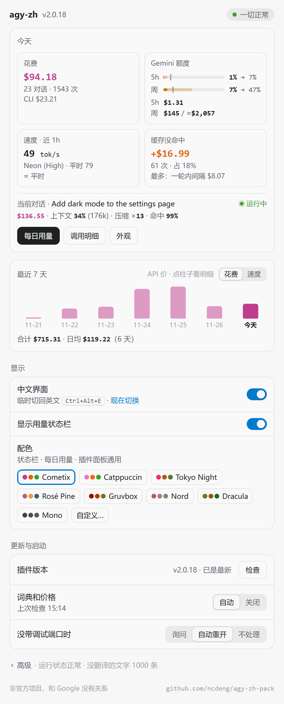

<div align="center">

# agy-zh

[简体中文](README.md) | [English](README.en.md)

Antigravity 桌面版的中文插件：整套界面汉化，加一条输入框上方的用量状态栏。支持 Windows 和 macOS。

[](https://github.com/ncdeng/agy-zh-pack/releases/latest)
[](LICENSE)


</div>

## 亮点

- **整套界面中文**：菜单、设置、按钮、提示和 Swarm 面板，3582 条词典加 128 条规则。对话、代码、文件名保持原样。按 `Ctrl+Alt+E`（macOS 是 `Ctrl+Option+E`）随时切回英文对照。
- **用量一眼可见**：输入框上方两行，写模型（含接口实际返回的名字）、上下文、缓存命中、对话花费、今天花费、首字时间、生成速度、5h 和每周额度。子代理各占一行。
- **额度够不够用**：按现在的速度推算到重置时会用到多少、会不会提前用完；再按花费推出 5h 和每周额度大约值多少钱。
- **每日用量面板**：7 天、30 天或全部历史的花费，每天的 token 和额度，每次调用的明细，每个模型的生成速度。
- **缓存没命中**：找出没走缓存的大调用，写出多花了多少钱、是什么原因（停顿、压缩、换模型）。
- **压缩查看器**：点上下文后面的 `↻3×`，看自动压缩以后智能体手里还剩什么。
- **8 套配色，可以自定义**：Cometix、Catppuccin、Tokyo Night、Rosé Pine、Gruvbox、Nord、Dracula、Mono，跟着 Antigravity 切浅色和深色；花费、5h 额度、周额度、提醒这 4 个主色可以自己挑。
- **agy CLI 一起算**：CLI 的调用算进花费、调用明细和额度预估。
- **签名更新**：在插件面板里点“更新”，先校验作者签名和每个文件再安装。词典和价格每 6 小时在线更新。

## 安装

**Windows**

1. 安装 Antigravity，登录一次。
2. 从 [Releases](https://github.com/ncdeng/agy-zh-pack/releases/latest) 下载 `agy-zh-pack-v<版本>.zip`，解压到任意位置。
3. 双击 `一键安装.cmd`。出现“Windows 已保护你的电脑”时，点“更多信息”，再点“仍要运行”。
4. 以后从开始菜单、桌面或任务栏的图标打开 Antigravity。安装程序给这些快捷方式加了 `--remote-debugging-port=0`。

Antigravity 开着也可以装。这次启动没带这个参数时，安装程序会问你，回车后它会重开 Antigravity。

**macOS**

1. 安装 Antigravity，登录一次。
2. 解压安装包。打开“终端”，输入 `bash` 和一个空格，把 `一键安装.command` 拖进窗口，按回车。
3. 安装程序问“没带调试端口启动时要不要自动重开”，回车选自动重开。

装好以后，在 Antigravity 右上角的“插件”菜单里打开 **agy-zh**。以后有新版本，在这个面板里点“更新”。请保留解压出来的文件夹，卸载时要用。

<details>
<summary>从 v1.x（中文美化包）升级</summary>

下载新的安装包，运行一次 `一键安装`。旧版的每日记录和外观设置会自动搬过来，旧版的开机自启会删掉。

</details>

## 汉化

| 内容 | 怎么处理 |
|---|---|
| 菜单、设置、按钮、提示、报错 | 翻成中文。报错悬停显示英文原文，方便搜索和反馈 |
| Swarm 面板 | 界面文字翻成中文；智能体写的目标、任务和消息保持原文 |
| Antigravity 的功能名 | Artifact、Turbo、Coordinator、Swarm 保留英文，和官方文档一致；MCP、URL、token 这类术语也保留 |
| 你或第三方起的名字 | 对话标题、项目名、文件和路径、分支、MCP 服务器名都不翻 |
| 单独出现、意思不定的词 | 例如 Plan、Type、Space，保持英文 |

- 只要状态栏：在插件面板里关掉“中文界面”。只要汉化：关掉“显示用量状态栏”。
- 查不到译文的界面文字记在数据目录的 `i18n-missing.json`，只在本机。插件面板“高级”里可以查看和清空。想帮忙补词典，可以把其中的文字贴到 issue 里。
- 设置页的一部分说明由 Antigravity 后台下发。后台改了文字时，这些地方先变回英文。

## 状态栏

状态栏上的字和 ccline 一样用英文。鼠标停在任何一项上，显示中文说明。

| 行 | 示例 | 说明 |
|---|---|---|
| 第一行 | `Gemini 4 Neon · XHigh · gemini-4-neon` | 模型：界面名、思考档位、接口实际返回的模型名。Gemini 模型两者对不上时标黄 |
| | `61% · 311k · ↻3×` | 上下文：已用比例和 token 数，图标是随用量变满的圆环。`↻3×` 是自动压缩过 3 次，点它打开压缩查看器 |
| | `98% hit` | 最近一次调用的缓存命中率 |
| | `$4.49` | 这个对话累计花费（含子代理）。单次调用 ≥ $0.50 时后面多一个红色徽章 |
| | `$4.49 today` | 今天的花费（0 点起，所有对话和 agy CLI）。点它打开每日用量面板 |
| | `running` | 正在生成 |
| 第二行 | `11.4s` | 首字时间 |
| | `74 tok/s` | 生成速度 |
| | `1% · 19:41` | 5h 额度：已用比例和重置时间 |
| | `1% · 11-29 09:41 · ↓3%` | 每周额度：已用比例、重置时间、比匀速用得快（↑）还是慢（↓） |
| 子代理 | `├ research · Paper Reviewer … ● 1m05s` | 每个子代理一行：类型和任务、模型、上下文、命中率、花费、状态（运行时间、`waiting` 或 `✓ done`） |

## 插件面板



| 区块 | 内容 |
|---|---|
| 顶部 | 版本号和状态点。没带调试端口、有新版本时出现横幅，带“带参数重启”或“更新”按钮 |
| 今天 | 四个格子：花费；当前模型那组的 5h 和周额度（实色是已用，浅色画到预计用到的位置，下面写已花的钱和推出的额度）；最近 1 小时的生成速度和平时比；缓存没命中多花的钱。不正常的格子标黄 |
| 当前对话 | 累计花费、上下文、压缩次数、缓存命中率 |
| 最近 7 天 | `花费 \| 速度` 切换：每天的花费（点柱子看那天的明细），或一天内每小时的生成速度 |
| 显示 | 中文界面、用量状态栏两个开关；配色 |
| 更新与启动 | 插件版本和“检查”；词典和价格的在线更新；没带调试端口时怎么办 |
| 高级 | 运行状态、文件和签名是否一致、内存、没翻译的界面文字 |

## 每日用量面板

点状态栏上的 `$x today` 打开，再点一次或按 `Esc` 关掉。


| 部分 | 内容 |
|---|---|
| 顶部 | 今天的花费、调用次数、token 数、缓存命中率；右上角是账号（邮箱打码）、`speed` 和 `theme` |
| 柱状图 | `7d`、`30d` 或 `all` 每天的花费，按模型分颜色。`↺` 是那天额度被提前重置过 |
| 表格 | 每天的花费、对话数、调用数、token、命中率、用掉了多少每周额度。点一行打开那天的调用明细 |
| 调用明细 | 每次调用的时间、对话、模型、花费、token、命中率、速度、首字时间。可以按对话或按模型汇总，可以只看缓存没命中的、只看 agy CLI 的。单次 ≥ $0.50 的标红 |
| speed | 每小时和每天的生成速度中位数；现在比平时慢四成以上时标出来 |
| 底部 | 这段时间的合计和日均；今天缓存没命中多花的钱；每组 5h 和每周额度：已用 → 预估、重置时间、`cap ≈` |

装上以后，插件从本机的对话库补算以前每天的用量（补算的天没有额度记录）。历史保留 400 天。

## 外观

在每日用量面板右上角点 `theme`。选了立刻生效，所有窗口一起换。

| 选项 | 可选值 | 默认 |
|---|---|---|
| 配色 | Cometix、Catppuccin、Tokyo Night、Rosé Pine、Gruvbox、Nord、Dracula、Mono | Cometix |
| 外形 | `plain` 竖线分隔；`pill` 圆角色块；`powerline` 箭头色块 | `plain` |
| 额度进度条 | `thin`、`cells`（10 格）、`ring`（小圆环）、`none` | `thin` |
| 信息密度 | `compact`、`full`（上下文带上限，缓存带 token 数） | `compact` |
| 图标 | `material`、`outline`、`unicode`（不用图标字体）、`off` | `material` |
| 单项图标 | 每一项有一个备选图标，例如生成速度可以换成三档仪表 | 默认图标 |

- 配色也可以在插件面板的“显示 → 配色”里换。状态栏、每日用量面板和插件面板用同一套。
- 点“自定义…”可以改 4 个主色：花费、5h 额度、周额度、提醒 / 超额。浅色和深色主题各存一份。点“还原成 <配色名>”或点任何一套配色，就回到原来的颜色。
- Cometix 是本项目的默认配色，名字和外观来自 ccline 的 cometix 预设，色值以 Catppuccin 为底。

## 额度预估

每日用量面板底部，每组额度一行，例如：

```
Gemini 5h · 1% → est 7% · resets 21:03 · cap ≈ $170
Gemini weekly · 7% → est 47% · resets Thu 15:03 · cap ≈ $2,055 ↺
```

| 写法 | 意思 |
|---|---|
| `7% → est 47%` | 已用 7%，照现在的速度，到重置时用到 47% |
| `full 12-1 20:00` | 照现在的速度，会在这个时间用完 |
| `cap ≈ $2,055` | 整个额度大约值多少钱 = 这个周期的花费 ÷ 已用比例 |
| `(rough)` | 已用不到 5%，或这周才过去不到 1 天，数字很粗 |
| `↺` | 这个周期是在一次提前重置之后开始的 |
| `not started` | 这一组这个周期还没用过 |

- 每周额度的速度取最近 24 小时（至少有 6 小时的读数），没有就取这周的平均。5h 额度按这 5 小时的平均速度算，过了 30 分钟才开始估。
- 花费按 API 标准价折算，token 和花费按同样的比例推。悬停可以看钱和 token 两种写法；每周额度的悬停还列出以前 4 个周期各自的 cap。cap 变小，说明额度可能收紧了。
- 额度按账号算。开了家庭组共享，或别的电脑也在用这个号时，`cap` 偏低、`est` 偏高。

## 费用

费用 = token 数 × Google / Anthropic 公开的 API 标准价，折成美元。订阅按额度扣，这里的金额是折算值。

<details>
<summary>单价表（美元 / 百万 token）</summary>

| 模型 | 输入 | 缓存读取 | 输出（含思考） |
|---|---|---|---|
| Gemini 4 Neon（含 Orchestrator (Neon) 的规划） | $3 | $0.15 | $15 |
| Gemini 4 Carbon / Argon（含 Orchestrator 的规划） | $2（12-01 起 $4） | $0.10（12-01 起 $0.20） | $10（12-01 起 $20） |
| Gemini 4 Hydrogen（含 Orchestrator 的执行模型） | $1.50 | $0.075 | $7.50 |
| Gemini 3.8 Flash | $0.75（2027-01-01 起 $1.50） | $0.075（同日起 $0.15） | $3.75（同日起 $7.50） |
| Claude Opus 5.5 | $4 | $0.20 | $20 |
| Claude Sonnet 5.5 | $2 | $0.10 | $10 |

- Claude 的缓存写入按 5 分钟缓存计：Opus 5.5 $5，Sonnet 5.5 $2.50。
- `gemini-4-hydrogen-tiered-high`（浏览器子代理用）按 Gemini 4 Hydrogen 的价格算。GPT-OSS 120B 没有单价，不计入。
- 出处：Google AI Studio 价格页（2026-11-16；Neon 2026-11-19）、Anthropic 官方价（2026-11-03）。Claude 在 Antigravity 里经 Google Vertex 调用。
- 单价默认用在线价格表 `data/prices.json`，GitHub Actions 每天按官方价格页核对。下载不到时用 `statusbar.js` 里内置的 `PRICES`。
- 每次调用按它自己开始的时间算进哪一天、用哪一天的单价。`/btw` 和分叉出来的对话只算它们自己的调用，复制过来的旧调用不重复算。

</details>

## 缓存没命中

同一个对话里，每次调用都和这个模型上一次输入 ≥ 2 万 token 的调用比。前面那段上下文本该走缓存、这次却按全价算了，就算没命中。多花的钱 = 漏掉的 token ×（输入单价 − 缓存读单价）。

| 原因 | 面板上写 | 怎么判断 |
|---|---|---|
| 换了模型 | `model switch` | 这个模型在对话里第一次出现 |
| 刚压缩过 | `compaction` | 中间有压缩，或者输入比上一次少了 40% 以上 |
| 你停了一会儿 | `your pause` | 隔了 1 分钟以上，中间有你发的消息 |
| 一轮中间停了 | `agent pause` | 隔了 1 分钟以上，中间没有你的消息（长命令、等批准、等子代理） |
| 停了一会儿（agy CLI） | `pause` | CLI 的调用分不出中间有没有你的消息 |
| 其他 | `other` | 不到 1 分钟也没命中 |

作者电脑上 11-17～11-24 的 4143 次调用：隔不到 30 秒时 Gemini 命中 90%～95%；隔 2～5 分钟，Hydrogen 有 59%、Carbon 有 41% 的调用完全没命中。这 7 天没命中多花约 $161，占花费的 39%。

## 更新

**词典和价格**每 6 小时从本仓库下载一次：先向 `api.github.com` 问 main 分支最新的提交，再按这个提交从 jsDelivr（备用 `raw.githubusercontent.com`）下载 `i18n/zh-CN.json`、`i18n/zh-CN.rules.json`、`data/prices.json`、`data/meta.json`。

- 下载走 Antigravity 自己的网络和代理设置，不带 cookie。
- 词典只当文字填进界面，价格只当数字用。格式不对、条数少了两成以上、单价超出范围的文件不用。
- 在线词典覆盖自带词典里的同名条目。
- 在插件面板 → 更新与启动 →“词典和价格”选“关闭”，就不再联网，也不检查新版本。

**版本**只在你点“更新”时安装：

1. 下载那个版本的签名清单 `plugin-manifest.json`，用插件里的公钥校验 Ed25519 签名。
2. 下载每个文件，逐个核对 sha256 和大小。
3. 全部对上以后，把现在的文件备份到数据目录的 `backup/v<版本>/`，再替换。中途出错就用备份恢复。
4. 插件自动重启（约 2 秒），Antigravity 不用关。

签名私钥只在作者电脑上，公钥指纹是 `246b2f1a387df2c5`。GitHub 上的代码被人改了，也装不进来。

## 调试端口

插件经 Antigravity 的 Chromium 远程调试端口改界面。Antigravity 2.33.0 起，要带 `--remote-debugging-port` 启动才有这个端口。

- **Windows**：安装程序给目标是 `%LOCALAPPDATA%\Programs\antigravity\Antigravity.exe` 的快捷方式加上 `--remote-debugging-port=0`（随机端口）。Antigravity 自动更新改掉快捷方式时，插件会补回去。
- **macOS**：从程序坞或启动台打开时总是不带参数。

这次启动没带参数时，插件约 20 秒后按面板里的设置处理：

| 设置 | 做什么 |
|---|---|
| 询问（Windows 默认） | 弹框问要不要现在重开 Antigravity |
| 自动重开（macOS 推荐） | 直接重开：先正常关闭，再带参数打开，约 6 秒。对话记录保留，正在跑的任务会中断 |
| 不处理 | 什么都不做，界面保持英文 |

检查 Windows 快捷方式：

```powershell
powershell -ExecutionPolicy Bypass -File "$env:USERPROFILE\.gemini\config\plugins\agy-zh-pack\debug-port.ps1" -Mode check
```

## 数据

| 位置 | 路径 |
|---|---|
| 插件目录 | `~/.gemini/config/plugins/agy-zh-pack`（Windows：`%USERPROFILE%\.gemini\config\plugins\agy-zh-pack`） |
| 数据目录 | `~/.gemini/antigravity/plugin_data/agy-zh-pack`（Windows：`%USERPROFILE%\.gemini\antigravity\plugin_data\agy-zh-pack`） |

数据目录里的文件：

| 文件 | 内容 |
|---|---|
| `usage-history.json` | 每天的金额、调用数、token 数、额度比例、生成速度摘要 |
| `cost-day.json` | 今天每个对话的花费 |
| `quota-samples.json` | 额度读数（8 天） |
| `cli-index.json` | 每个 agy CLI 对话库在哪几天有调用 |
| `look.json` | 外观和在线更新开关 |
| `settings.json` | 没带调试端口时的处理方式 |
| `i18n-missing.json` | 没翻译的界面文字 |
| `remote/` | 在线下载的词典和价格表 |
| `inject.log`、`relaunch.log` | 日志 |

- 不存对话内容。账号只存打码后的邮箱和一个编号（邮箱的哈希）。
- 插件更新时换的是插件目录，数据目录不动。
- 读对话库、额度、账号都是只读，不改发给 Google 的内容。
- 联网只有三处：从 Google Fonts 加载图标字体；在线更新词典和价格；点“更新”时下载新版本。
- 插件面板的接口只听本机 `127.0.0.1`，要带 Antigravity 给的令牌。

## 风险

- Antigravity 附加服务条款第 6 条不允许 “using the Service in connection with products not provided by us”。用第三方插件，账号有被暂停的可能。
- 调试端口开在本机 `127.0.0.1`。本机的其他程序可以经这个端口控制 Antigravity 窗口。
- “自动重开”会关掉 Antigravity，正在运行的任务会中断。不想这样就选“询问”或“不处理”。
- 插件依赖 Antigravity 内部的页面结构和接口。Antigravity 更新后，部分功能可能失效，新加的界面文字先显示英文。

## 卸载

运行 `一键卸载`（Windows 双击 `一键卸载.cmd`；macOS 在终端里用 `bash` 运行 `一键卸载.command`）：

- 去掉快捷方式上的启动参数，删掉插件目录。刷新一下 Antigravity 窗口就变回英文。
- 最后问要不要连数据目录一起删。保留的话，以后重装还能接着用以前的记录。
- 以前用过“作者的配色”（v2.0.16 及以前）的，会问要不要恢复原来的颜色。

## 环境要求

- Antigravity 2.35 起要用 v2.0.12 或更新的版本。测试版本是 2.35.2（Windows 11 和 macOS 真机），每一版测了什么见 [docs/testing.md](docs/testing.md)。
- 插件用 Antigravity 自带的 Node 运行，不用另装 Node.js。
- 图标字体从 Google Fonts 加载。连不上时，在外观里选 `unicode` 图标。

## 开发

```bash
node --test "tests/*.test.mjs"      # 单元测试（Node.js 22.13+）
node tools/dev/probe.mjs all        # 开着 Antigravity 时，检查插件在真实界面里的显示
```

插件怎么启动、注入、重开，从源码运行、打包发版和每个文件的作用，见 [docs/development.md](docs/development.md)。

## 致谢

- 状态栏的外观和英文写法借鉴 Haleclipse（哈雷）的 [CCometixLine](https://github.com/Haleclipse/CCometixLine)（ccline）的 cometix 预设；外观分层（配色、外形、进度条、详略）和上下文圆环参考 ccline v2。本项目没有用 ccline 的代码。感谢哈雷做出这么好看的状态栏。
- 5h 和每周额度的显示方式参考 agyline。
- 配色的色值取自各方案公开的定义：[Catppuccin](https://catppuccin.com)、[Tokyo Night](https://github.com/folke/tokyonight.nvim)、[Rosé Pine](https://rosepinetheme.com)、[Gruvbox](https://github.com/morhetz/gruvbox)、[Nord](https://www.nordtheme.com)、[Dracula](https://draculatheme.com)（浅色是官方的 Alucard）。Nord 官方只有深色，浅色版把偏淡的颜色调深了。
- 图标：Material Symbols 和 Material Icons “translate”（Apache License 2.0）；模型的备选图标是 [Font Awesome Free](https://fontawesome.com) 6.7.2 的 meteor（[CC BY 4.0](https://fontawesome.com/license/free)，Fonticons, Inc.）。

## 许可

[MIT](LICENSE)

本项目是非官方项目，和 Google 没有关系。Antigravity 是 Google 的产品。词典 `zh-CN.json` 的键是 Antigravity 的界面英文原文，用于匹配要翻译的文字。
